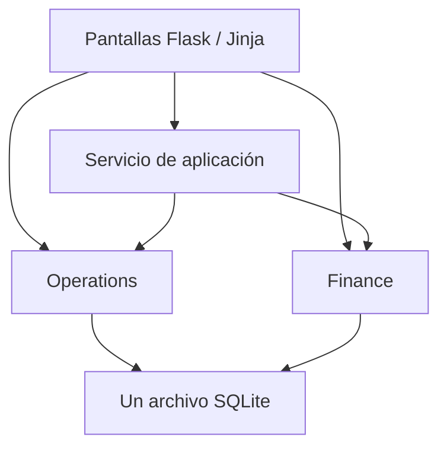

# Clinic Operations & Finance — revisión y guía de desarrollo para Cursor

**Fecha de referencia: 7 de octubre de 2026, Europe/Madrid. Entrega: 12 de octubre; comprobar hora en el portal.**

Documento preparado para Alejandro Serrano Sánchez. El código utiliza `Medic` como nombre provisional; no se considera una marca elegida. Esta guía revisa `Archivo.zip` y concreta la continuación del proyecto. Complementa el plan inicial del 6 de octubre y sustituye sus instrucciones de implementación donde aquí se indica una corrección. El enunciado del profesor sigue teniendo prioridad. No es el informe académico final de 4–5 páginas.

**Actualización del 7 de octubre, tras la revisión:** Alejandro ha elegido personalizar los tiempos por profesional y prueba. La sección 6.5 especifica esta ampliación; sus reglas sustituyen el uso exclusivo de una duración global. Es trabajo por implementar, no una función presente en el ZIP.

## 1. Dictamen y decisión de producto

Hay una base aprovechable. Mantener Python, Flask, Jinja, SQLite y la estructura actual. No rehacer la aplicación ni introducir un frontend separado. El siguiente esfuerzo debe convertir las reglas declaradas en comportamientos comprobables y completar Finance.

Hoy funciona una agenda básica con persistencia, sesiones, solicitudes, reservas y cancelación. Todavía no funciona el producto completo: faltan recuperación de huecos, realización de pruebas, conciliación de cobros y escenarios de inversión. La separación en carpetas está preparada, pero Finance contiene únicamente una descripción. Sus tablas y tarifas de ejemplo no bastan para contar como segundo dominio funcional.

**Propuesta de valor a demostrar:** ayudar al responsable de una pequeña clínica a aprovechar su capacidad disponible, seguir el dinero de las pruebas realizadas y explicar si una inversión resolvería realmente su limitación de capacidad. La conexión entre estas decisiones debe verse en una demostración, no solo en el título de tres pantallas.

Para esta entrega: una clínica ficticia, EUR, un calendario local, gastroscopia y colonoscopia, decisiones humanas explícitas, sin datos clínicos reales. Cápsula endoscópica queda especificada para la siguiente fase: requiere un modelo de recursos diferente. No hace falta ayuda de familiares ni acceso hospitalario para completar esta versión.

## 2. Alcance y evidencia de la revisión

Se inspeccionaron los 25 archivos de código/documentación del ZIP, excluyendo archivos compilados y metadatos del empaquetado. Se extrajo una copia aislada: no se modificó el código entregado, no se hicieron commits y no se realizaron pushes.

- ZIP SHA-256: `daaa3637fe478c17621638f921b56ac28e2998d31df1a2148060982d3f52714d`.
- Entorno de comprobación: Python 3.12.14; instalación limpia de los tres requisitos fijados: Flask 3.1.3, pytest 9.0.2, pytest-cov 7.1.0. No se verificó ejecución en Python 3.10 o en el Mac del alumno.
- Las **11 pruebas entregadas pasan**. Son pruebas útiles de conflictos, cancelación y persistencia, pero no cubren los fallos descritos en §4.
- Arranque real con `python app.py`, `DATA_DIR` temporal y `PORT` distinto del predeterminado: SQLite creado automáticamente; `/`, `/capacity` y CSS devolvieron HTTP 200; `APP_NAME` se aplicó; servidor enlazado a `0.0.0.0`, sin reloader. Disponible en aproximadamente 0,53 s en este entorno. No es un benchmark ni prueba de carga.
- Revisión de HTML/CSS y respuestas HTTP; no se hizo evaluación visual en navegador ni auditoría completa de seguridad.
- El ZIP no aporta el historial ni la evidencia remota necesaria para verificar commits, distribución por días o fechas de push. Los nombres de checkpoints de `AI_USAGE.md` no prueban que se hayan enviado a GitHub.
- `PROJECT_BRIEF.md` y README registran aprobación confirmada por Alejandro el 7 de octubre. Se toma como estado declarado del proyecto, sin afirmar una verificación independiente del mensaje del profesor. No volver a bloquear el trabajo por aprobación pendiente salvo que Alejandro corrija ese estado.

### Cobertura medida

Comando ejecutado sobre las pruebas originales, sin incluir los experimentos de auditoría:

```bash
python -m pytest --cov=clinic.operations --cov=clinic.finance --cov=clinic.timeutil --cov-report=term-missing
```

| Archivo/ámbito | Cobertura de líneas | Interpretación |
|---|---:|---|
| `clinic/operations/service.py` | 65/72 = 90,28% | Buena cobertura del código existente; faltan reglas enteras que no aparecen en ese denominador. |
| `clinic/operations/repository.py` | 52/61 = 85,25% | Contiene también decisiones de negocio; debe incluirse al medir el núcleo. |
| `clinic/timeutil.py` | 11/16 = 68,75% | Validaciones y formateo incompletamente cubiertos. |
| `clinic/operations/routes.py` | 16/46 = 34,78% | No confundir cobertura de rutas con cobertura de negocio. |
| Conjunto medido | 144/195 = 73,85% | El 74% redondeado NO acredita los dos dominios. |
| Finance | No evaluable como dominio funcional | Coverage advierte que `clinic.finance` no se importó. |

El núcleo actual Operations + repository + timeutil tiene 128/149 líneas cubiertas (85,91%). Es una medida de la implementación existente, no de completitud de requisitos ni corrección clínica.

## 3. Contrato del assignment y estado real

El enunciado recibido imprime una fecha anterior. Esta guía usa el 12 de octubre indicado por Alejandro; verificar la hora real de entrega sin cambiar fechas del historial.

| Requisito | Estado en el ZIP | Acción/evidencia para terminar |
|---|---|---|
| Aplicación individual y caso aprobado antes de implementación | Aprobación declarada en documentación; Git no verificable | Conservar evidencia real de aprobación y repositorio individual. |
| Monolito, un proceso, SQLite en una ruta | Cumplimiento observado | Mantener `python app.py`, `0.0.0.0`, `PORT`, `DATA_DIR/clinic.sqlite3`. |
| Un manifiesto raíz | Cumple: `requirements.txt` | No añadir manifiestos por dominio ni build Node. |
| Sin Docker/Compose/CI/IaC propios ni despliegue público | No presentes en archivos entregados | Conservar restricción en el repositorio real. |
| Dos dominios con datos, reglas y lectura/escritura SQLite | Operations parcial; Finance pendiente | Completar conciliación y escenarios guardados. |
| ≥70% cobertura del núcleo de los dos dominios | Solo núcleo actual de Operations medible | Medir todos los módulos con reglas; garantizar además ≥70% por dominio para evitar que uno oculte al otro. |
| Exactamente cinco ADR en la raíz | Tres entradas: 6 y 7 de octubre | Añadir ADR-4 y ADR-5 al decidir de verdad; cinco entradas en ≥3 fechas reales de commit. |
| `AI_USAGE.md` específico y explicado por el alumno | Cuatro filas con TODO y hashes provisionales | Completar explicaciones propias, prompts representativos y referencias reales. |
| ≥12 commits significativos, ≥6 días, ningún día >40% | No verificable | Verificar GitHub; conservar fechas reales de push. |
| Informe de 4–5 páginas con SDLC, SMART y diagramas | No incluido | Escribir al final sobre lo que realmente existe. |
| README ejecutable y cobertura medida | Arranque documentado y probado; cobertura sin resultado final | Añadir comando y resultados finales auténticos, versión Python probada y límites del modelo. |
| Comprensión escrita | No comprobada | Practicar explicación de funciones, SQL, invariantes y decisiones sin consultar el código. |

Ponderación: funcionalidades 20%, pruebas 15%, calidad/Git 20%, documentación 15%, proceso 30%. La comprensión escrita **multiplica** el subtotal: por ejemplo, 90 × 0,60 = 54. No se puede garantizar un 10; ampliar funciones sin comprenderlas puede perjudicar la nota.

## 4. Hallazgos reproducidos y prioridad de corrección

**P0 = corregir antes de construir recuperación o Finance sobre ese comportamiento. P1 = necesario para una entrega coherente. P2 = mejora acotada si no retrasa lo anterior.** Los experimentos se ejecutaron sobre bases temporales; no son cambios aplicados al proyecto.

### F1 — P0: duración de prueba ignorada

Ubicación: `clinic/operations/repository.py::create_booking`; formulario de reserva en `capacity.html`.

La consulta carga `turnover_minutes`, pero no `duration_minutes`. Se aceptó una gastroscopia de `10:00` a `10:01`, aunque el catálogo establece 30 minutos. El usuario puede comprimir una prueba cambiando la hora final.

Corrección: recibir inicio y calcular el final en servidor desde el perfil vigente de profesional + prueba, con sus componentes y el mínimo de planificación aprobado por el centro (sección 6.5). Si no hay perfil, usar los valores predeterminados del catálogo. Si se conserva `end_time` como entrada de compatibilidad, exigir que coincida con el final calculado. Mostrar final y ocupación derivadas; no confiar en cálculo del navegador. En esta versión no introducir duraciones excepcionales por paciente.

Aceptación sin perfil particular: GASTRO a las 10:00 termina a las 10:30; con margen de sala 10 ocupa hasta 10:40. Con un perfil particular, calcular desde sus valores guardados, no imponer siempre 30 minutos. Un final 10:01 se rechaza sin escritura. COLONO utiliza 45 minutos y su propio margen.

### F2 — P0: elegibilidad almacenada pero no aplicada

Ubicación: `create_request`, `create_booking`, futura selección de candidatos.

Se aceptaron reservas con `ready=False`, disponibilidad exclusivamente al día siguiente y antelación mínima de 1.000.000 minutos. No existe reloj ni comprobación temporal en el flujo actual. Que estos campos estén en SQLite no significa que gobiernen las reservas.

Corrección: una función compartida de elegibilidad debe validar disponibilidad, antelación, duración, estado de solicitud y autorización humana para el hueco propuesto. Aplicarla tanto a reserva manual confirmada como a aceptación de una propuesta. La preparación no se calcula a partir de un número de minutos; ver §6.

### F3 — P0: dos peticiones simultáneas pueden ocupar el mismo hueco

Ubicación: `create_session` y `create_booking`, secuencia comprobar → insertar → `db.commit()`.

Reproducción controlada: dos conexiones SQLite, dos solicitudes diferentes, ambas validando 10:00–10:30 en sesión 1 antes de insertar. Ambas reservaron: quedaron **dos reservas activas en el mismo intervalo**. La restricción de una reserva activa por solicitud no evita colisiones entre solicitudes distintas. Un solo proceso Flask puede atender peticiones concurrentes.

Corrección: adquirir transacción de escritura antes de leer el estado utilizado para decidir. Para este monolito pequeño, usar `BEGIN IMMEDIATE` en el servicio que orquesta la operación, validar de nuevo, escribir y terminar con commit/rollback. Manejar ocupación de base de datos con error legible o reintento acotado de la operación completa. No añadir Redis, mutex global como única protección, ni servicios externos. SQLite documenta que IMMEDIATE inicia una transacción de escritura y puede fallar con BUSY si otra escritura ya está activa [T1].

Las funciones SQL que participen en una operación compuesta no deben hacer commits internos. Refactorizar con alcance claro: servicio dueño de la transacción; repositorio ejecuta consultas. No basta con envolver una función que ya hace commit dentro de otra transacción.

Aceptación: dos intentos concurrentes para un hueco producen como máximo una reserva; el otro informa del conflicto. Verificar también sesión duplicada y aceptación de propuesta obsoleta.

### F4 — P1: entradas inválidas y formatos inconsistentes

Ubicación: `timeutil.py`, `create_session`, `create_request`, rutas de formularios.

- Una sesión con fecha `nonsense` y sala vacía tras eliminar espacios se guardó.
- `9:00` se interpreta como hora válida por Python, pero almacenarlo frente a `12:00` dispara el CHECK textual `start_time < end_time`.
- POST de solicitud con antelación `-1` genera `sqlite3.IntegrityError` no manejado; con TESTING se propaga, y en funcionamiento normal termina en error 500.
- Se aceptó una sesión superpuesta usando `room a` frente a la sala existente `Room A` porque la identidad se compara como texto exacto.

Corrección mínima: fechas reales ISO, horas canónicas `HH:MM`, datetimes consistentes, nombres no vacíos, prioridad acotada y documentada, antelación no negativa, `available_from < available_to`. Usar selectores de recursos existentes cuando sea posible; aplicar normalización consistente a nombres. No crear un sistema de usuarios para resolver esto. A futuro, IDs de recursos y tablas de recursos eliminan la ambigüedad de nombres.

Capturar errores de integridad previsibles, hacer rollback y convertirlos en errores de dominio. No esconder errores de programación con un `except Exception` indiscriminado. Mantener lo introducido en el formulario cuando falle.

### F5 — P1: finalización abriría la puerta a repetir una solicitud ya realizada

Actualmente no existe finalización en la UI. En un experimento con una reserva marcada `completed` por SQL, `create_booking` permitió reservar nuevamente la misma solicitud. Es un riesgo de la siguiente funcionalidad, no una finalización disponible hoy.

Definir solicitud como un episodio concreto de prueba. Una solicitud con una reserva completada queda satisfecha; una repetición clínica requiere otra solicitud. Una cancelada puede volver a reservarse. Las reservas completadas deben seguir ocupando su intervalo histórico, aunque no estén pendientes de ejecución.

### F6 — P1: métricas de lista de espera incorrectas

`clinic/__init__.py::overview` cuenta todas las solicitudes y muestra el total como “waiting requests”. La base inicial muestra 1 en espera y 1 reserva activa correspondiente a la misma solicitud.

Corregir listado y contador: espera = solicitudes sin reserva activa ni completada; definir aparte cuántas son elegibles para un hueco. No llamar pacientes únicos a un conteo de solicitudes. Añadir métrica “minutos reservados” solo cuando los intervalos sean fiables.

### F7 — P1: valores históricos dependen del catálogo actual

`list_bookings` y los conflictos recuperan el margen actual de `procedure_types`. Si se cambia el catálogo, cambiaría retroactivamente la ocupación atribuida a reservas previas. No existe hoy una pantalla para editar ese catálogo: el riesgo aumenta al hacer los tiempos configurables.

Guardar en cada reserva una instantánea del perfil aplicado: duración estimada, margen de variabilidad, mínimo de planificación aplicado, bloque resultante y margen de sala. Guardar también la referencia al perfil o indicar que se usó el catálogo predeterminado. `end_time` representa el final del bloque asistencial planificado; ocupación de sala termina al añadir el margen guardado. Mantener las tarifas esperadas históricas en Finance de forma análoga.

### F8 — P1: documentación y demostración todavía reflejan fases distintas

`ACCEPTANCE_CRITERIA.md` indica aprobación pendiente y “not implemented”; README/brief indican aprobación confirmada. En el brief también queda un encabezado de frontera referido a aprobación pendiente. Actualizar estados sin borrar la cronología. Mapear cada caso a pendiente, implementado o verificado, con prueba concreta cuando exista.

Las fechas de seed/formularios son fijas, alrededor del 10 de octubre. El 12 de octubre la recuperación puede resultar inelegible por estar en el pasado. Resolverlo explícitamente; no desactivar comprobaciones de tiempo para que la demo pase. Véase §9.

### F9 — P2: inicialización y argumentos de arquitectura que conviene afinar

- `seed_if_empty` detecta una tabla vacía, no una instalación ya inicializada. Si se eliminan todos los datos respetando FKs, puede regenerar ejemplos al reiniciar. El test actual solo demuestra que dos arranques normales no duplican filas. Preferir una marca persistente de inicialización si se soporta vaciar datos.
- `CREATE TABLE IF NOT EXISTS` no añade columnas a una base existente. Para incorporar instantáneas, hacer una migración pequeña, versionada e idempotente; no borrar automáticamente `clinic.sqlite3` ni pedir un reset manual para arrancar.
- ADR-3 habla de evitar FK entre dominios para `source_booking_id`, pero `fee_assumptions.procedure_code` sí tiene FK hacia `procedure_types`. Es válido mantener esa dependencia de catálogo en el monolito si se declara; no afirmar independencia completa de almacenamiento. No eliminar la FK solo para aparentar separación.
- ADR-1 puede comparar Flask con FastAPI sirviendo HTML en el mismo proceso; FastAPI no obliga a una SPA ni a otro proceso. ADR-2 debería distinguir una cola externa prohibida de un bus en memoria, que se puede rechazar por complejidad innecesaria. Refinar argumentos en la fecha real del cambio.

## 5. Arquitectura: tres áreas de producto, dos dominios

Un dominio agrupa responsabilidad, reglas y datos persistidos. No es una pantalla, una carpeta vacía ni un servicio desplegado.

| Dominio | Datos que posee | Decisiones de negocio |
|---|---|---|
| Operations | `procedure_types`, `sessions`, `requests`, `bookings`, `recovery_proposals` | Huecos válidos, conflictos, elegibilidad, orden de candidatos, estados de reserva. |
| Finance | `fee_assumptions`, `receivables`, `payments`, `investment_scenarios` | Importe esperado, saldo, estados de cobro, duplicados, escenarios económicos. |
| Servicio de aplicación | Ningún tercer conjunto de datos | Coordina finalizar prueba y crear cuenta pendiente en una transacción. |

**Objetivo de arquitectura, todavía no completamente implementado:**



Mantener `clinic/operations/service.py` para reglas, `repository.py` para SQL y `routes.py` para HTTP. Construir Finance con `reconciliation.py`, `investment.py`, `repository.py` y `routes.py`. El servicio `clinic/application.py` hace la composición explícita. No añadir interfaces abstractas, ORM, contenedor de inyección, API interna HTTP ni un framework de eventos.

Operations no importa Finance. Finance recibe un identificador estable de actividad, código de prueba y datos necesarios; no consulta por su cuenta todas las tablas de Operations. La FK de catálogo existente se documenta como dependencia conocida. La futura separación física requerirá cambiar transacciones y referencias; las carpetas actuales no resuelven por sí solas la consistencia distribuida.

**Ejemplo comprensible:** Operations sabe que la reserva 17 se ha realizado. Finance sabe que esa actividad genera 120 € esperados y que se han recibido 90 €. El servicio de aplicación garantiza que las dos escrituras ocurren juntas. La lista de espera nunca se ordena por esos 120 €.

## 6. Investigación clínica aplicada al modelo

Estas fuentes sirven para definir conceptos del software. No constituyen protocolos del centro, autorización clínica ni instrucciones de preparación para pacientes. Diferenciar hechos de una fuente, supuestos de demostración y decisiones de diseño.

### 6.1 Duraciones: 30 y 45 como referencias predeterminadas, con perfiles particulares

La SEPD publica tiempos medios de referencia para programar prestaciones: gastroscopia 30 min y colonoscopia 45 min, con una nota que incluye sedación e informe [C1]. Coinciden numéricamente con el seed, pero eso no demuestra que el código original se basara en la fuente. Documentarla ahora, sin inventar investigación previa.

Interpretación propuesta: `duration_minutes` es un **bloque asistencial planificado**, no exclusivamente minutos con el endoscopio dentro del paciente. El documento no desglosa qué recurso ocupa cada minuto ni valida un margen adicional concreto. Los 10/15 minutos de `turnover_minutes` siguen siendo supuestos ficticios del proyecto. Antes de un piloto habrá que aclarar qué incluye cada tiempo para evitar doble conteo.

Guy’s and St Thomas’ describe gastroscopias de 5–15 minutos y recuperación posterior diferenciada si hay sedación [C2]. No contradice necesariamente la referencia SEPD: están describiendo medidas diferentes. No sustituir el bloque de agenda por el tiempo de exploración aislado.

### 6.2 Catálogo operativo y siguiente fase

| Prueba/sistema | Evidencia relevante | Decisión para el programa |
|---|---|---|
| Gastroscopia | Tiempo de agenda de referencia y preparación/recuperación diferenciadas [C1, C2] | Bloque configurado; margen separado; profesional confirma que puede programarse en ese hueco. |
| Colonoscopia | Preparación previa y su relación con la hora del procedimiento [C3] | No sustituir preparación por `minimum_notice_minutes`; volver a confirmar viabilidad si se adelanta una cita. |
| Cápsula con grabador externo | En el protocolo de UCLH se devuelven grabador y cinturón, y la cápsula es desechable [C4] | En fase posterior, préstamo de un equipo individual hasta devolución y puesta a punto; sala ocupada solo para tareas presenciales. |
| CapsoCam | El sistema descrito por Guy’s no requiere equipo externo puesto y exige recuperar/devolver la cápsula [C5, C6] | Variante propia; no aplicar automáticamente el flujo de préstamo del grabador. |

La tabla SEPD también recoge 105 minutos para cápsula, pero no desglosa ese tiempo [C1]. **No inferir que el paciente ocupa una sala durante 105 minutos, ni que el grabador queda libre entonces.** Hace falta distinguir colocación, registro ambulatorio, devolución, descarga/revisión y preparación del equipo.

### 6.3 Preparación y significado de `ready`

La guía ESGE 2019 muestra que la preparación de colonoscopia depende de la programación del procedimiento y de instrucciones concretas [C3]. Por eso adelantar una cita puede invalidar una confirmación previa. Esta aplicación no debe prescribir laxantes, ayuno, cambios de medicación, sedación ni idoneidad clínica.

En el MVP, `ready` debe significar **“un profesional ha confirmado la aptitud de programación para la ventana propuesta”**, no “el algoritmo ha verificado preparación clínica” ni “el paciente ya completó hoy toda la preparación de una cita futura”. Etiquetarlo así en UI y documentación. No marcarlo automáticamente por tiempo transcurrido. No dejarlo seleccionado por defecto en un formulario nuevo.

Al aceptar una recuperación, requerir confirmación humana para la nueva hora, además de comprobar disponibilidad y antelación. Guardar fecha/hora y confirmación en la propuesta aceptada si se añade ese campo. Si falta, devolver `needs_staff_confirmation`. Conservar prioridad asignada por personal, sin calcular urgencia a partir de diagnósticos.

Para esta versión todas las reservas creadas son confirmadas; no existe estado provisional. Si se quiere admitir solicitudes futuras todavía pendientes de revisión, deben permanecer como solicitudes, no como huecos clínicamente aprobados.

### 6.4 Sala, equipo y recuperación no son el mismo recurso

ESGE/ESGENA describe un proceso específico de reprocesamiento de endoscopios, con pasos e instrucciones del fabricante [C7]. Un margen de sala de diez minutos no certifica que un endoscopio esté reprocesado. No equiparar “turnover” a esterilización ni al tiempo completo de recuperación.

Supuesto explícito del MVP: cada sesión es un bloque con sala, profesional y apoyo necesario previamente confirmados por la clínica; hay equipamiento preparado suficiente para las pruebas previstas. No se modelan agendas de anestesia, camas de recuperación, lavadoras/desinfectadoras ni unidades individuales de endoscopio. La pantalla debe decir que comprueba las restricciones representadas, no toda la viabilidad clínica.

Después de la entrega, añadir recursos concretos y reservas por fase cuando la validación lo justifique. Para una cápsula con grabador: `available → loaned → returned → preparing → available`, con devolución prevista y real distintas. Una fecha prevista no libera automáticamente un equipo no devuelto. El tiempo de revisión profesional también puede limitar actividad aunque sobren grabadores.

### 6.5 Perfiles por profesional y prueba — ampliación acordada

**Incluir la versión manual en el MVP.** Cada profesional puede tener un perfil para GASTRO y otro para COLONO, definido con el responsable del centro. No inferir tiempos por años de experiencia, no ordenar profesionales por rapidez y no exigir datos reales para la entrega. Usar dos perfiles ficticios claramente etiquetados.

Datos del perfil: profesional identificado de forma estable, código de prueba, duración estimada del bloque asistencial, margen de variabilidad no negativo, origen de la estimación y fecha de revisión. Definir qué incluye el bloque; no confundir minutos de exploración con sedación, documentación y demás tareas incluidas. La configuración por procedimiento del centro conserva el tiempo de preparación de sala y el mínimo de planificación aprobado; el médico no reduce automáticamente esos valores al modificar su estimación.

Modelo simplificado, explícito y determinista:

```text
estimacion = perfil del profesional y prueba, o valor predeterminado del catálogo
margen_variabilidad = valor del perfil, o 0 en los ejemplos originales
bloque_asistencial = max(minimo_planificacion_centro, estimacion + margen_variabilidad)
fin_reserva = inicio + bloque_asistencial
fin_ocupacion_sala = fin_reserva + margen_preparacion_sala
```

Un margen de +5 minutos es una decisión de planificación, no un intervalo estadístico ±5 ni una garantía de duración. Los valores se revisan por el centro y se respetan los criterios de calidad aplicables. Como referencia, ESGE 2025 distingue inspección y hueco de agenda, recomendando un hueco de al menos 20 minutos para endoscopia alta diagnóstica [C8]. Ese número no se extrapola a todas las pruebas ni convierte este programa en un verificador de calidad clínica.

Ejemplo ficticio para una misma prueba, suponiendo que el mínimo aprobado no supera los bloques calculados: profesional A estima 25 minutos, añade 5 de margen y la sala requiere 10 después → bloque 30, ocupación 40. Profesional B estima 35, añade 5 y la misma sala requiere 10 → bloque 40, ocupación 50. En un hueco de 45 minutos solo cabe el primer perfil, sin cambiar la prioridad clínica de las solicitudes ni reasignar un paciente a otro médico automáticamente.

Seleccionar el perfil del profesional asignado a la sesión. Esta regla debe ser compartida por reserva manual, propuesta de recuperación y aceptación transaccional. Mostrar en la UI de dónde sale el tiempo y sus componentes. Guardar los componentes aplicados en la reserva: editar un perfil posteriormente afecta a nuevas reservas, no desplaza las existentes. Para reprogramar una reserva, ejecutar un flujo explícito con validación de conflictos.

Persistencia acotada: añadir una tabla pequeña de profesionales con ID estable si no existe, y una de perfiles con unicidad `(clinician_id, procedure_code)` y claves foráneas. Las sesiones referencian ese profesional. Migrar las etiquetas existentes sin eliminar sesiones; normalizar variantes inequívocas y no fusionar personas ambiguas silenciosamente. Esto añade dos tablas de Operations, no otro dominio ni un sistema de usuarios/login. Actualizar schema, migración, ADR-3 y diagrama real.

Pruebas adicionales: dos profesionales/misma prueba producen bloques diferentes; ausencia de perfil usa catálogo; mínimo del centro prevalece; valores inválidos se rechazan; exactamente 40 minutos caben para A y 39 no; 45 no bastan para B; editar el perfil no cambia reservas previas; candidatos y reservas manuales utilizan el mismo cálculo. Probar que el margen de variabilidad no se suma dos veces.

Más adelante: registrar tiempos observados con definiciones consistentes y comparar estimación con realidad. Una sesión observada inicial no establece una distribución fiable. Las futuras sugerencias necesitarán muestras suficientes de casos comparables y revisión humana; no incluir aprendizaje automático ni cambios automáticos de agenda en esta entrega. La investigación ya estudia predicción de duraciones y planificación adaptativa [M4], por lo que la originalidad comercial debe validarse en la integración y facilidad de uso.

## 7. Especificación de Operations para Cursor

### 7.1 Invariantes

1. Toda hora se valida y normaliza antes de SQL. Limitar esta versión a sesiones dentro del mismo día; rechazar cruces de medianoche explícitamente.
2. Intervalos semiabiertos: `[inicio, fin)`. Hay solapamiento si `a_inicio < b_fin` y `b_inicio < a_fin`. Tocar el extremo es válido.
3. Ocupación de reserva = inicio hasta fin del bloque + margen guardado. Debe caber dentro de la sesión completa.
4. Sesiones superpuestas no comparten sala ni profesional. Identidad de recurso consistente.
5. Una solicitud tiene como máximo una reserva activa y no puede reservarse si ya fue completada. Las cancelaciones permanecen en el historial.
6. Las reservas activas y completadas ocupan su intervalo; las canceladas no.
7. Las validaciones que dependen de estado de base se repiten en la transacción que escribe. La UI no es autoridad.
8. El paciente está disponible durante el bloque asistencial. El margen de sala posterior no exige que el paciente siga disponible. La recuperación posterior no está modelada y no se puede prometer que el programa la comprueba.
9. La disponibilidad humana para el nuevo hueco, prioridad, tiempo de aviso y confirmación de programación son condiciones separadas.

### 7.2 Candidatos y propuestas

Un caso mínimo defendible: cancelar una reserva y evaluar solicitudes en espera para el mismo intervalo liberado. En este release la sustitución permanece dentro del intervalo previamente ocupado por la reserva cancelada; no implementar optimización combinatoria de toda la agenda.

Filtrar por compatibilidad del tipo de sesión si se introduce esa restricción; en caso contrario, declarar que las sesiones iniciales admiten los dos tipos configurados. No inventar credenciales profesionales desde el nombre del médico.

Cada candidato lleva resultado y motivos: `duration_does_not_fit`, `outside_availability`, `insufficient_notice`, `not_ready`, `already_booked`, `already_completed`, `needs_staff_confirmation`. La UI muestra texto comprensible. El catálogo financiero no entra en el orden.

Ordenar elegibles por prioridad descendente, `requested_at` ascendente e ID ascendente. Persistir propuestas en `recovery_proposals`; sugerir no reserva capacidad. Al aceptar, leer la propuesta, comprobar que sigue sugerida y que su reserva original sigue cancelada, revalidar, crear reserva y cambiar estado a aceptada en la misma transacción. Una nueva petición repetida no puede crear otra reserva.

Si falla por obsolescencia, no sobrescribir reservas. Informar claramente y marcar `stale` mediante un flujo deliberado que no deje una reserva parcial. No ejecutar un rollback que borre también el estado que se pretende mostrar sin advertirlo.

### 7.3 Estados de reserva

`active → cancelled` o `active → completed`. No completar una cancelada. Cancelar no genera cuenta pendiente. Completar una ya completada devuelve el resultado existente o un mensaje estable, sin duplicar actividad económica.

Para la demo, no marcar actividad futura como realizada usando el reloj real. Usar datos ya pasados o el reloj de demostración explícito de §9. La implementación debe distinguir el reloj de planificación del supuesto de haber prestado el servicio.

## 8. Finance: implementación real y criterios de aceptación

### 8.1 Finalizar una prueba y capturar su importe

Construir una operación propuesta `complete_booking(db, booking_id, performed_date, due_date)` en `clinic/application.py`; el nombre puede adaptarse, manteniendo la responsabilidad. No existe aún en el ZIP.

Dentro de una sola transacción:

1. Leer reserva y comprobar transición permitida.
2. Obtener datos mínimos de Operations: identificador, código de prueba y fecha de actividad.
3. Finance obtiene la tarifa vigente, valida importe y fechas y prepara una cuenta pendiente.
4. Marcar reserva completada e insertar `receivables` con `source_booking_id` único e importe esperado congelado.
5. Confirmar ambas escrituras; ante error, revertir ambas.

No usar commits en funciones intermedias. Probar que un error provocado al insertar la cuenta deja la reserva activa y cero cuentas nuevas. Probar doble clic y repetición de la operación. La unicidad en SQLite complementa, no sustituye, la validación de negocio.

### 8.2 Cobros y saldos

Dinero almacenado en céntimos enteros. Para el formulario, convertir con `Decimal`; propuesta simple: aceptar como máximo dos decimales y rechazar precisión adicional, NaN, infinito, valores negativos y texto inválido. Documentar el separador admitido y poner ejemplos. Evitar redondeos silenciosos y floats binarios.

```text
pagado = suma de payments.amount_cents de esa cuenta
saldo = expected_fee_cents - pagado
```

| Situación | Estado |
|---|---|
| Esperado > 0 y pagado = 0 | unpaid |
| 0 < pagado < esperado | partial |
| pagado = esperado, incluido 0 = 0 | settled |
| pagado > esperado | overpaid; mostrar exceso |

`overdue` es una bandera adicional: saldo positivo y fecha de vencimiento anterior a la fecha de consulta. No llamar fraude, impago definitivo ni error de aseguradora a todo saldo pendiente.

Una referencia de pago globalmente única es una simplificación válida del MVP: explicarla. Si se repite con la misma cuenta, importe y fecha, devolver el pago existente o un mensaje de duplicado; no sumarlo. Si se repite con valores distintos, rechazar como conflicto de referencia. No ocultar una diferencia devolviendo éxito.

Permitir múltiples pagos legítimos con referencias distintas. Nunca cambiar expectativas históricas al editar tarifas. No eliminar cuentas con pagos. Reembolsos, remesas colectivas, impuestos, factura legal, liquidaciones de médicos y porcentajes hospitalarios quedan fuera de esta entrega.

Aceptación numérica ficticia: esperado 12.000 céntimos; P1=9.000 deja 3.000; P2=3.000 deja 0; repetir P1 no cambia total; una cuenta con pagos acumulados de 13.000 muestra 1.000 de exceso. El backend calcula estados al recargar desde SQLite.

### 8.3 Escenarios de equipo: mantener, comprar y alquilar

Esta funcionalidad pertenece también a Finance; no necesita un tercer dominio ni otro servicio. Un tipo de procedimiento por escenario. Todas las capacidades expresadas en **procedimientos de ese tipo por mes**; no mezclar minutos con pacientes ni reutilizar el mismo tiempo de personal simultáneamente para dos escenarios como si ambos pudieran ejecutarse juntos.

Para cada opción `o`:

```text
q[o] = min(demanda_mensual, capacidad_personal[o], capacidad_sala[o], capacidad_equipo[o])
cobros_estimados[o] = q[o] * cobro_esperado_por_prueba
coste_variable[o] = q[o] * coste_variable_por_prueba
flujo_mensual[o] = cobros_estimados[o] - coste_variable[o]
                   - coste_personal_adicional[o] - coste_equipo_mensual[o]
caja_horizonte[o] = meses * flujo_mensual[o] - desembolso_inicial[o]
caja_incremental[o] = caja_horizonte[o] - caja_horizonte[mantener]
```

Para el caso más simple mantener iguales personal y sala entre opciones; si se permite aumentarlos, exigir el coste adicional correspondiente y mostrarlo. `capacidad_equipo` es capacidad total resultante, no solo la unidad comprada. No suponer que se gana actividad por comprar si el límite es personal, sala o demanda.

Coste mensual de equipo incluye las categorías introducidas para esa opción: mantenimiento y, cuando proceda, alquiler. Compra/setup se resta una vez al inicio; no añadir depreciación en este modelo de caja. Usar mismo horizonte y categorías comparables. Identificar todos los límites empatados, no solo el primer mínimo.

**Ejemplo aritmético para tests, sin representar precios de mercado:** 12 meses; demanda 30; personal 12; sala 20; equipo actual 10 y nuevo 40; cobro esperado 120 €, variable 25 €; compra inicial 5.000 €, mantenimiento de compra 50 €/mes; alquiler 300 €/mes con mantenimiento incluido y sin entrada; mantener 0 € de coste adicional supuesto. Contribución por prueba 95 €. Mantener: 11.400 € de caja modelada; comprar: 8.080 €; alquilar: 10.080 €. Frente a mantener: compra −3.320 €, alquiler −1.320 €. El nuevo equipo aumenta actividad de 10 a 12, no a 40. El ejemplo muestra que más capacidad no garantiza una mejor decisión.

No presentar estas cifras como beneficio contable ni recomendación de inversión. Son un escenario parcial con costes comunes omitidos, demanda constante y cobro en el mismo mes; excluye financiación, impuestos, impagos, valor residual y descuento. Mostrar hipótesis en pantalla. Un déficit de caja estimada no demuestra inviabilidad real sin costes/ingresos completos.

Persistir nombre, código, versión del modelo, fecha y JSON de entradas/salidas. Validar cantidades, dinero y horizonte (propuesta 1–60 meses), conservar enteros en JSON para importes. Al abrir un escenario, mostrar sus supuestos guardados; cambios futuros de tarifas no deben reescribirlo.

## 9. Modelo de datos, reloj y experiencia de uso

### Cambios mínimos en SQLite

Conservar las nueve tablas existentes y añadir únicamente las dos pequeñas tablas de profesionales/perfiles descritas en 6.5, con su migración. Añadir campos solo cuando resuelvan invariantes identificadas: snapshots de duración/margen en reserva; vínculo explícito entre propuesta aceptada y reserva creada si se necesita idempotencia/trazabilidad; confirmación humana de nueva hora si se registra. No duplicar todos los datos entre dominios.

Actualizar ADR-3 y el diagrama cuando cambie el schema, conservando historial real. Usar una pequeña migración automática, transaccional e idempotente para bases previas. Backfill de reservas actuales desde catálogo es una reconstrucción con el único valor disponible, no una prueba de su duración histórica. No cambiar importes o estados sin razón.

En el diagrama final incluir columnas relevantes, PK, FK, unicidades y la referencia lógica de `source_booking_id`. Diferenciar una flecha lógica de una FK realmente declarada. Los índices parciales y CHECK también son parte de la explicación de integridad.

### Tiempo reproducible

Todas las decisiones temporales reciben `now` explícito desde una función de reloj, no llaman cada una por su cuenta al reloj del sistema. Documentar Europe/Madrid. Normalizar datetimes a una convención consistente; si se usa hora local sin zona para este MVP, limitarlo a una clínica y rechazar horas ambiguas/inexistentes del cambio horario. Alternativamente, usar datetimes con zona y UTC en almacenamiento. Elegir una sola convención que Alejandro pueda explicar.

Para tests y demo, una opción pequeña es `DEMO_NOW` por variable de entorno con fecha/hora ISO válida. Sin ella se usa tiempo real. Si se activa, mostrar un banner persistente “Demo clock: …”. La demo no debe depender de la fecha fija del seed ni falsear el historial de Git. Si se necesita avanzar de planificación a realización, reiniciar con otra hora de demo conservando la misma base. Los tiempos de test se pasan directamente a las funciones.

### Pantallas orientadas a decisiones

- **Overview:** pendientes reales, reservas confirmadas, cobros esperados/recibidos/pendientes del periodo seleccionado y enlaces a acciones. No estadísticas inventadas ni llamar ingresos a dinero todavía no cobrado.
- **Capacity:** selector de fecha/sesión, intervalos y margen visibles, cancelación y lista explicada de candidatos. Selectores con etiquetas en lugar de obligar a memorizar IDs.
- **Payments:** actividad realizada, esperado, recibido, pendiente y vencimiento; detalle de pagos y formulario. Confirmación clara tras guardar y errores legibles.
- **Investment:** entradas con unidades, tres resultados comparables, recurso limitante y posibilidad de guardar/reabrir.

Conservar CSS local, diseño legible y responsive. Distinguir estado también con texto, no solo color; labels en formularios; foco visible; tablas con desbordamiento controlado en móvil. No dedicar días a branding, animaciones o dashboards antes de cerrar los flujos.

## 10. Backlog por hitos y fechas reales

Estos son trabajos futuros, no commits que se afirme ya realizados. Si los hitos de los días 6 y 7 ya están enviados, no rehacerlos para encajar en esta tabla. Verificar la situación en el repositorio real.

**Los dos hitos previstos para hoy, 7 de octubre, ya tienen código en el ZIP:** (1) base ejecutable Flask/SQLite, configuración, seed y persistencia; (2) pantalla Capacity, sesiones/solicitudes/reservas/cancelación, reglas de conflicto y pruebas. Mensajes propuestos si esos cambios siguen sin commitear: `feat: add configurable Flask app with persistent SQLite storage` y `feat: add capacity workflows with conflict checks and tests`. Son nombres descriptivos, no una afirmación de que existan esos commits.

Antes de crear nada, comprobar commits locales, relación con la rama remota y cambios pendientes. Si ambos hitos ya están commiteados y publicados, hoy no hacen falta otros dos. Si están commiteados pero sin publicar, enviar los existentes. Si siguen sin commitear, agrupar los cambios pendientes en dos unidades lógicas comprobables sin inventar etapas, sin modificar fechas y sin deshacer commits existentes. Si ya se agruparon ambos en un único commit, conservarlo: la especificación de perfiles/revisión puede ser un segundo cambio sustantivo de documentación si aún no está versionada; no crear uno vacío ni dividir historia publicada. Un commit local y la coincidencia con remoto no prueban por sí solos la hora de push: mostrar por separado qué evidencia se pudo consultar.

| Fecha | Hito 1 | Hito 2 | Evidencia/proceso |
|---|---|---|---|
| 7 oct., revisión | Incorporar/leer esta guía y comprobar estado real | Resolver dudas de comprensión; no terminar todo el proyecto esta noche | Registrar esta revisión en AI_USAGE si se utiliza. No generar un commit vacío por calendario. |
| 8 oct. | Corregir F1–F4 incorporando perfiles manuales por profesional/prueba, snapshots, transacciones y regresiones | Elegibilidad, candidatos, propuestas persistidas y aceptación válida/obsoleta | ADR-4: estrategia de pruebas realmente adoptada. |
| 9 oct. | Finalización + receivable atómica, snapshot de tarifa y errores | Pagos, conciliación, pantalla y casos duplicados/parciales/exceso | Explicar personalmente frontera entre dominios y rollback. |
| 10 oct. | Cálculo mantener/comprar/alquilar con casos de límites | Guardar/reabrir escenarios y UI transparente | ADR-5: omisión deliberada de integraciones reales y por qué. |
| 11 oct. | Flujo completo de demo, métricas correctas, cobertura y arranque limpio | README final, diagramas reales, informe 4–5 páginas y ensayo | Verificar cinco ADR, AI_USAGE, Git y acceso del profesor. |
| 12 oct. | Margen para correcciones reales y entrega | No asumir hora de cierre | Entregar antes de la hora confirmada. |

Seis fechas 6–11 permiten 12 commits si hubo dos trabajos genuinos por día; la revisión no ha verificado esos pushes. Si falta algún día, calcular el margen real hasta el 12 y actuar honestamente; no modificar fechas ni simular trabajo. Un push puede contener varios commits: lo relevante es sustancia, cadencia y evidencia remota, no pulsar dos veces un botón.

Git local puede mostrar commits pero no demuestra por sí solo fechas de push. Cursor debe inspeccionar `git status`, rama y remoto; conservar trabajo ajeno, no forzar pushes ni reescribir historia publicada. El alumno mantiene su flujo actual de commit/push, salvo autorización expresa para que Cursor los ejecute. No fabricar identidad ni aprobaciones.

Si el tiempo se complica: recortar decoración, filtros y variedad de escenarios; conservar un flujo Operations completo, Finance persistente con conciliación, y una comparación de equipo pequeña guardable. Cápsula, importaciones, machine learning y despliegue siguen posteriores.

## 11. Pruebas que faltan y definición de terminado

Las pruebas deben verificar resultados e invariantes, no repetir línea a línea la implementación. No fijar un número arbitrario de tests; cubrir los riesgos identificados.

| Grupo | Casos necesarios |
|---|---|
| Reservas | Duración derivada, margen fuera de sesión, límites exactos, horas/fechas inválidas, nombres normalizados, cancelación. |
| Elegibilidad | No preparado/confirmado, fuera de disponibilidad, aviso justo al límite y un minuto insuficiente, solicitud ya activa/completada, prioridad estable sin dinero. |
| Persistencia/competencia | Dos reservas para mismo hueco, propuesta obsoleta, doble aceptación, reinicio, migración idempotente. |
| Aplicación | Completar una vez/repetido/cancelado; fallo de Finance revierte todo; no cuenta por cancelación. |
| Conciliación | Cero, parcial, liquidado, exceso, vencimiento, referencias duplicadas iguales/distintas, importes inválidos y snapshot histórico. |
| Inversión | Personal/sala/equipo/demanda limitante; empate; cero demanda; meses inválidos; aritmética del ejemplo; guardar y reabrir. |
| HTTP mínimo | Páginas principales accesibles; entradas inválidas devuelven error comprensible y no 500; ningún cambio de datos con GET. |

Comando general al existir ambos dominios:

```bash
python -m pytest --cov=clinic.operations --cov=clinic.finance --cov=clinic.application --cov=clinic.timeutil --cov-report=term-missing --cov-fail-under=70
```

Ese umbral es conjunto. Revisar también cada dominio y todos sus módulos con reglas. No excluir repositorios que todavía contienen decisiones para aumentar la cifra. Puede ejecutarse la suite completa con un ámbito de cobertura por dominio; documentar qué se mide. Añadir pruebas de frontera aunque las líneas ya estén cubiertas.

Un hito termina cuando: su caso visible funciona, persiste y sobrevive recarga; sus reglas se prueban; el resultado no depende de datos hardcodeados en HTML; documentación refleja su estado; Alejandro puede explicarlo; el diff está revisado. Solo entonces realizar el commit y push real del hito.

## 12. Defensa ante el profesor

### Demostración breve

1. Mostrar datos ficticios y hora de demo, si se utiliza.
2. Enseñar una sesión con una cancelación y tres solicitudes: elegible, demasiado larga y pendiente de confirmación. Explicar por qué unas se excluyen y el orden de las otras.
3. Aceptar una propuesta; repetir un intento obsoleto para mostrar que no ocupa dos veces el hueco.
4. Con fecha de actividad válida, registrar realización: mostrar exactamente una cuenta pendiente.
5. Introducir 90 € sobre 120 € esperados; luego 30 €; repetir referencia y demostrar que no duplica.
6. Comparar equipo actual y nuevo: aumentar capacidad de equipo no elimina un límite de personal. Guardar y reabrir escenario.

No llamar “ingreso adicional generado” al valor de una cita adelantada. Puede mejorar utilización o momento del cobro sin crear actividad adicional a largo plazo. Mostrar esa distinción es una fortaleza del modelo.

### Preguntas para responder sin notas

1. ¿Qué hace `create_app`, dónde se crea SQLite y cómo se obtiene una conexión por contexto? Debes poder seguir `get_db`, `g`, `init_db` y `close_db`.
2. ¿Por qué `[inicio, fin)` permite citas adyacentes? Resuelve un ejemplo con margen usando `intervals_overlap`.
3. ¿Por qué dos validaciones correctas pueden terminar en doble reserva? Dibuja el intercalado lectura/lectura/escritura/escritura y explica qué cambia con la transacción.
4. ¿Qué pertenece a Operations, qué a Finance y qué hace `clinic/application.py`? Señala tablas y funciones reales al terminar.
5. ¿Por qué guardas céntimos y snapshots? Explica pago parcial, cambio posterior de tarifa, duplicado e idempotencia.
6. ¿Qué significa `min(demanda, personal, sala, equipo)`? Da un caso donde comprar no mejora la actividad y explica un límite del modelo.

Estas son guías de estudio, no texto para fingir comprensión en AI_USAGE. Alejandro debe escribir sus respuestas con sus propias palabras y contrastarlas con la versión final. Si no puede explicar un módulo, simplificarlo antes de añadir otro.

### Informe final de cinco páginas como máximo

Distribución orientativa: 1) problema, usuario, objetivos SMART y alcance; 2) SDLC iterativo elegido y qué pasó realmente; 3) arquitectura y frontera; 4) schema y reglas principales; 5) pruebas, límites, siguientes pasos y declaración de IA. Ajustar longitud para que los diagramas se lean y el resultado tenga 4–5 páginas.

Objetivos SMART posibles: completar los tres flujos acordados antes del 11 de octubre, verificar persistencia y reglas con pruebas, superar 70% en núcleo de ambos dominios, y arrancar en pocos segundos mediante el contrato documentado. No inventar satisfacción de clientes ni ahorros clínicos medidos. Explicar desviaciones del plan, incluidos los fallos detectados en esta revisión.

Mantener exactamente cinco entradas ADR. Si cambia una decisión existente, actualizar esa entrada con nota fechada y dejar que Git muestre su evolución; no crear una sexta para cada ajuste. Preservar las fechas originales auténticas, sin atribuir decisiones nuevas al pasado.

## 13. Camino comercial después del assignment

La investigación confirma productos con funcionalidades relacionadas: EndoSoft ofrece programación por procedimiento/recurso [M1]; Nubimed/SEOGA describe conciliación de actos y liquidaciones de aseguradoras [M2]; TRIMEDX ofrece planificación de activos basada en uso [M3]. No hay evidencia suficiente para afirmar que la combinación propuesta sea única o que clínicas concretas pagarían por ella.

Hipótesis de diferenciación a validar: una herramienta fácil de adoptar para pequeñas unidades de pruebas, que explique **qué capacidad se puede recuperar realmente, qué caja está pendiente y si el límite que frena crecimiento es equipo o personal**. Es una dirección de producto propuesta, no un hueco de mercado demostrado.

La primera conversación comercial debería centrarse en un coordinador/gerente que hoy reconstruye estas respuestas con agenda y hojas de cálculo. Los contactos familiares pueden servir después, pero no son requisito de la primera versión ni prueba de demanda.

### Fase posterior 1 — validar problema y acceso a datos

Hacer cinco entrevistas de descubrimiento con perfiles de coordinación, gerencia y facturación; este número es una meta propuesta. Preguntar por la última cancelación sin cubrir, pasos para sustituirla, causas de inelegibilidad, revisión de cobros y última decisión de compra de equipo. Solicitar ejemplos de procesos o formatos anonimizados, no historias clínicas.

Registrar frecuencia y coste de trabajo administrativo, qué software utilizan, quién decide compra y qué impediría probar una herramienta. Buscar evidencia de un problema repetido y dos interesados en evaluar un prototipo; no presentar esos objetivos como clientes conseguidos. Si la mayoría ya lo resuelve bien con el sistema actual, estrechar o cambiar la propuesta.

### Fase posterior 2 — evaluar utilidad sin reemplazar la agenda clínica

Priorizar importación validada de CSV/exportaciones y trazabilidad, para evitar doble captura manual. Ejecutar primero sobre datos sintéticos o un conjunto autorizado y minimizado. Medir tiempo de conciliación, errores de referencia y concordancia con decisiones del coordinador. Atribuir ahorros solo si existe una comparación razonable; una demo no demuestra retorno económico.

Antes de usar datos reales: autenticación, permisos, auditoría, copias/restauración, revisión de privacidad y seguridad y validación del uso previsto con el centro. La versión local sin login del assignment no es una versión lista para producción. El desarrollo de esas medidas corresponde a una fase explícita, sin introducir ahora despliegues prohibidos.

### Fase posterior 3 — recursos que salen con el paciente

Si las entrevistas muestran un problema repetido con grabadores y devoluciones, desarrollar el módulo de préstamos para cápsula y, solo con protocolos validados, otros equipos ambulatorios. Modelar recurso, reserva, entrega, devolución real, puesta a punto y mantenimiento. No asumir que todas las cápsulas comparten materiales o flujo.

Esta ampliación conecta bien con inversión: puede explicar por qué comprar un grabador ayuda o no, considerando devoluciones, personal de colocación y capacidad de lectura. No es necesario construirla antes del 12 de octubre para tener una base extensible.

Posponer precios, TAM y afirmaciones de ROI hasta conocer esfuerzo de integración, utilidad repetida y disposición a pagar. No vender como “IA” unas reglas deterministas; su transparencia es una ventaja para esta fase.

## 14. Instrucción maestra para Cursor

Guardar este archivo en la raíz del repositorio. Copiar el bloque siguiente en Cursor. Es una especificación de trabajo; el código futuro debe seguir reflejando decisiones que Alejandro comprenda.

```text
Read CURSOR_REVIEW_AND_BUILD_GUIDE.md in full, the assignment brief if available,
README.md, PROJECT_BRIEF.md, ACCEPTANCE_CRITERIA.md, ADR.md, AI_USAGE.md and any
repository instructions. Inspect the actual current code, Git status, branch and
remote before editing. The uploaded review describes a snapshot from 7 October;
preserve improvements made since then and do not assume the snapshot is current.

Continue the existing Flask/Jinja/sqlite3 application. Do not rebuild the project,
change its provisional brand, add another runtime, Docker, CI, IaC, public hosting,
external databases, background workers, AI APIs or a separate frontend.

The first priority is the reproduced booking defects F1-F4: clinician/procedure
profiles per section 6.5 and derived duration,
shared eligibility, validated canonical input, and atomic conflict checking.
Respect the milestone sequence in section 10. Work on the next unfinished genuine
milestone, explain the small implementation plan, then implement and verify it.
For 7 October, first reconcile the two existing foundation/capacity milestones
with Git; do not regenerate them. Personalised profiles are the next operations
milestone, normally 8 October. Do not implement the entire remaining schedule
in one session unless I explicitly
change the plan. Do not create future-dated decisions or prewritten daily commits.

Keep Operations and Finance as two real backend domains using the same SQLite
file. Finance must gain real persisted reconciliation and saved investment
scenarios. Repositories used in composed operations must not commit internally.
The application service owns completion + receivable atomicity. Clinical priority
must never depend on fees, insurer or profitability.

Clinical timings must be labelled as reference values or fictional assumptions.
Ready is a human scheduling confirmation, not automated medical clearance.
Keep capsule/resource-loan workflows in the documented next phase for this release.
Do not generate preparation or medication instructions for patients.

Run relevant regression tests, record actual coverage when measured, and explain
what passed and what remains. Never claim Finance is complete because its folder
or tables exist. Preserve existing data through any schema update. Do not make
the demo work by bypassing time or conflict validation.

Update documentation to match actual implementation. Keep exactly five ADR
entries over at least three real commit dates. Record meaningful AI interactions
truthfully; leave Alejandro's own-word explanations for him to write or verify.
Do not invent commits, approval, clinical validation, users, revenue or push dates.

Follow my current commit/push workflow. If I ask you to push, use the verified
existing branch/remote, review the intended diff, and report the actual hash and
push outcome. No force push or rewriting published history. Otherwise leave the
completed milestone ready for me to commit and push.

At the end of the milestone: list files changed and why, evidence from tests,
remaining risks, the next task, and three questions I should answer to demonstrate
that I understand this specific code. Do not fill my answers on my behalf.
```

## 15. Fuentes y límites de uso

Consultadas para esta revisión del 7 de octubre de 2026. Las fuentes clínicas son referencias de sociedades y protocolos de centros concretos; no se certifica que sean el protocolo vigente de una clínica española. Las conclusiones de diseño están diferenciadas de las recomendaciones médicas. Los enlaces comerciales acreditan funciones anunciadas por sus proveedores, no resultados independientes ni demanda para este producto.

- **A1 — Enunciado aportado:** `Markdown pegado(1).md`, Individual Assignment 1. Fuente de requisitos académicos. Fecha de entrega corregida por Alejandro al 12 de octubre.
- **C1 — SEPD, Tiempos de referencia medios para las prestaciones de un Servicio de Aparato Digestivo:** https://admin.sepd.es/storage/cid/TIEMPOS%20MEDIOS%20SERVICIO/TIEMPOS%20MEDIOS%20SERVICIO.pdf — programación y nota sobre sedación/informe. No usar la cifra de cápsula como duración de préstamo.
- **C2 — Guy’s and St Thomas’, Having a gastroscopy, revisión abril de 2026:** https://www.guysandstthomas.nhs.uk/health-information/gastroscopy/having-gastroscopy — distingue procedimiento, preparación y recuperación en ese centro.
- **C3 — ESGE, Bowel preparation for colonoscopy, actualización 2019:** https://www.esge.com/assets/downloads/pdfs/guidelines/2019_a_0959_0505.pdf — muestra por qué preparación y hora de cita están relacionadas. No se convierte en un protocolo automatizado en la aplicación.
- **C4 — UCLH, Small Bowel Capsule Endoscopy:** https://www.uclh.nhs.uk/patients-and-visitors/patient-information-pages/capsule-endoscopy — devolución de equipo externo y cápsula desechable en el sistema descrito.
- **C5 — Guy’s and St Thomas’, CapsoCam, overview:** https://www.guysandstthomas.nhs.uk/health-information/video-capsule-endoscopy-with-capsocam — sistema sin equipo externo que deba llevar el paciente.
- **C6 — Guy’s and St Thomas’, CapsoCam, on the day:** https://www.guysandstthomas.nhs.uk/health-information/video-capsule-endoscopy-with-capsocam/day-your-vce — recuperación y devolución de la cápsula en ese flujo.
- **C8 — ESGE, Performance measures for upper gastrointestinal endoscopy, actualización 2025:** https://pubmed.ncbi.nlm.nih.gov/40934951/ — diferencia hueco asignado y tiempo de inspección en endoscopia alta diagnóstica.
- **C7 — ESGE/ESGENA, Reprocessing of flexible endoscopes, actualización 2018:** https://www.esge.com/assets/downloads/pdfs/guidelines/2018_a_0759_1629.pdf — proceso de reprocesamiento e instrucciones del fabricante; no respalda un margen universal de 10/15 minutos.
- **T1 — SQLite, Transaction:** https://www.sqlite.org/lang_transaction.html — semántica DEFERRED/IMMEDIATE y contención de escritura.
- **T2 — Flask, Define and Access the Database:** https://flask.palletsprojects.com/en/stable/tutorial/database/ — patrón de conexión por contexto. No copiar un reinicio destructivo/manual del tutorial al arranque de este proyecto.
- **M1 — EndoSoft, EndoVault Scheduler:** https://www.endosoft.com/endovault-ehr/scheduler/ — agenda configurable por procedimientos y recursos.
- **M2 — Nubimed, integración SEOGA:** https://www.nubimed.com/software-gestion-clinica-seoga/ — conciliación y liquidación de actos con aseguradoras.
- **M3 — TRIMEDX, TMX Optimize:** https://www.trimedx.com/technology/optimize — decisiones sobre equipamiento y planificación de capital basadas en utilización.

- **M4 — Reducing endoscopic procedure backlog by improving efficiency, Journal of the Canadian Association of Gastroenterology, 2026:** https://academic.oup.com/jcag/article/9/2/110/8466082 — investigación sobre predicción de duración y programación adaptativa; no prueba de demanda o resultados de esta aplicación.

## 16. Estado que debe conservar la siguiente sesión

Revisión completada; código original sin cambios. Base runnable verificada, 11 tests pasando, Operations parcial con defectos reproducidos, Finance pendiente. Primero verificar los dos hitos del 7 de octubre en Git. Prioridad de desarrollo siguiente: incorporar perfiles manuales de duración por profesional/prueba al corregir duración, elegibilidad, validación y transacciones, y luego implementar recuperación. Mantener los tres focos acordados y dos dominios. No dedicar la siguiente sesión a naming ni a añadir cápsula antes de cerrar esos flujos. Commits/pushes y explicaciones propias siguen pendientes de verificación en el repositorio del alumno.
