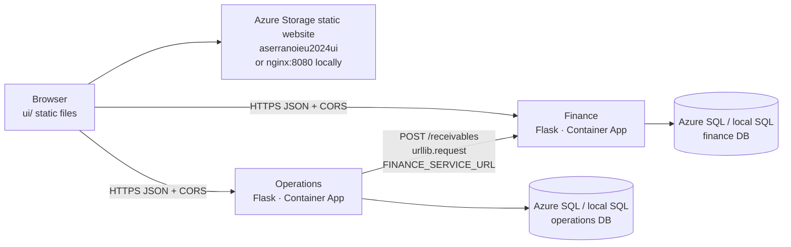

# Medic (Assignment 2)

Medic is a coursework app for a small private diagnostic clinic. All data is fictional.

**Assignment 2** is the current system: two Flask HTTP services (Operations and Finance), each with its own SQL Server database, a static browser UI, Docker Compose locally, and Azure Container Apps plus Azure Storage for the live site.

**Live UI:** https://aserranoieu2024ui.z28.web.core.windows.net/

**Repository:** https://github.com/alejandroserranosanchez/Medic

The Assignment 1 monolith (one process, SQLite, Jinja screens) remains in the repository for history. See [Legacy: Assignment 1](#legacy-assignment-1) at the end. Do not treat that section as the live architecture.

Process write-up: [`ADR.md`](ADR.md), [`AI_USAGE.md`](AI_USAGE.md). Machine-readable contracts: [`system.yaml`](system.yaml), [`system.schema.json`](system.schema.json), and each service’s `openapi.yaml`. The Assignment 1 report stays at [`docs/report.md`](docs/report.md); the Assignment 2 report is a separate deliverable.

## What works today

Through the static UI and the two APIs:

- Create sessions and bookings in **Operations**
- Complete a booking in Operations; Operations calls Finance over HTTP to create one receivable (server-side seam)
- Look up a receivable and record a payment in **Finance**
- Fees stay in Finance: **GASTRO 12000** cents, **COLONO 18000** cents

Not ported into the Assignment 2 APIs or static UI (still only in the Assignment 1 monolith):

- Keep / buy / lease equipment comparison
- Slot-recovery suggestions and waiting-request ranking
- Server-rendered Overview / Schedule / Collections screens

## Architecture



| Layer | Role |
|---|---|
| `ui/` | Static HTML/CSS/JS. `config.js` holds public API base URLs only (no database secrets). |
| Flask routes (`app/main.py`) | HTTP API: status codes, JSON, CORS from `UI_ORIGIN`. |
| Business logic (`completion.py`, `receivables.py`, `bookings.py`, …) | Rules the written check asks about. |
| `finance_client.py` | Operations → Finance with `urllib.request` and a finite timeout. |
| `pymssql` via `db.py` | Each service talks only to its own database using `DATABASE_URL`. |

## Run locally (Docker Compose)

Requires Docker Desktop. On Apple Silicon, enable Rosetta emulation; the SQL Server image is `linux/amd64`.

```bash
cp .env.example .env
# Edit .env: set the three passwords (letters/digits only; see comments in .env.example)
docker compose up --build
```

| URL | What |
|---|---|
| http://localhost:8080 | Static UI (nginx; not a third domain service) |
| http://127.0.0.1:8001 | Operations |
| http://127.0.0.1:8002 | Finance |

Open the UI as **localhost**, not `127.0.0.1` — those are different browser origins and CORS uses `UI_ORIGIN=http://localhost:8080`.

`db/init.sql` (one-off `sql-init` service) creates the `operations` and `finance` databases and one login each. Named volume `medic-sql-data` keeps data across `docker compose down`. `docker compose down -v` deletes the volume.

Quick health check:

```bash
curl http://127.0.0.1:8001/health
curl http://127.0.0.1:8002/health
```

Healthy response shape: `{"status":"ok","db":"ok","version":"<git sha>"}`. A local image without `GIT_SHA` returns `"unknown"`.

### Tests and coverage (per service)

```bash
cd services/operations   # or services/finance
pip install -r requirements.txt -r requirements-dev.txt
ruff check .
pytest --cov=app --cov-report=term-missing --cov-fail-under=70
```

CI runs the same pattern against a SQL Server service container. It never opens Azure SQL.

## Environment variables and secrets

Documented fully in [`system.yaml`](system.yaml). Summary:

| Variable | Who | Notes |
|---|---|---|
| `DATABASE_URL` | Both | Secret. Connection string for that service’s database only. |
| `PORT` | Both | Default `8000` inside the container. |
| `GIT_SHA` | Both | Stamped at image build; returned by `/health`. Default `unknown`. |
| `UI_ORIGIN` | Both | Allowed browser origin for CORS. Empty = no browser origin accepted. Compose: `http://localhost:8080`. Azure: Storage website origin **without** a trailing slash. |
| `FINANCE_SERVICE_URL` | Operations | Base URL of Finance. Application default is empty (unconfigured). Compose sets `http://finance:8000`. Azure sets the Finance HTTPS FQDN. |
| `FINANCE_TIMEOUT_SECONDS` | Operations | Default `3`. Invalid values fall back to 3. |
| `TZ` | Both | Compose and Azure set `Europe/Madrid`. When unset, containers use UTC. |

Local Compose passwords live only in `.env` (gitignored). On Azure, `DATABASE_URL` is a Container Apps secret referenced as `secretref:database-url`, not a plain env value in the portal definition. GitHub Actions uses OIDC (`AZURE_CLIENT_ID`, `AZURE_TENANT_ID`, `AZURE_SUBSCRIPTION_ID`) plus database URL secrets for deploy. Do not put secrets in `ui/config.js`, source, Compose, or images.

## Migrations and persistence

Each service has numbered SQL files under `services/<name>/migrations/`. On startup, `apply_migrations()` runs pending files in order and records filenames in `schema_migrations`. A second boot applies nothing. Applied files are not edited.

| Service | Files |
|---|---|
| Operations | `001_sessions.sql`, `002_bookings.sql`, `003_completion_state.sql` |
| Finance | `001_receivables.sql`, `002_payments.sql`, `003_fee_assumptions.sql` |

`003_completion_state.sql` alters existing `bookings` rows (nullable `finance_receivable_id`, status `completion_pending`) without dropping the table. Recovery for a bad migration is manual (see ADR-7): inspect, repair or restore, then a new forward migration.

## Cross-seam completion (partial failure)

1. Operations marks the booking `completion_pending`.
2. It calls Finance `POST /receivables` with booking id, procedure and dates (not the fee).
3. Finance looks up the fee catalogue and stores the snapshot. `source_booking_id` is unique.
4. On HTTP 200/201, Operations stores `finance_receivable_id` and marks the booking `completed`.
5. Connection refused on the first attempt → booking returns to `active`, HTTP 503.
6. Timeout / drop / HTTP 5xx → stays `completion_pending`, HTTP 503. Retry the same completion; Finance returns the existing receivable when details match (no second charge). Conflicting details → HTTP 409.

Stopping Finance with Compose leaves Operations domain APIs and `/health` working; completion fails in the designed way above.

## CI and CD

Pipeline on **push to `main`** (pull requests stop after tests + image **build**, with no push and no Azure):

**contracts + test → images (GHCR SHA tags) → Deploy Azure (backend) → Deploy UI**

| Workflow | Trigger | What it does |
|---|---|---|
| [`ci.yml`](.github/workflows/ci.yml) | Every push and pull request | Validate `system.yaml` + OpenAPI; Ruff + pytest with coverage ≥70% per service against SQL Server; build both images; on **main** only, push to GHCR as `ghcr.io/alejandroserranosanchez/medic-<service>:<full commit SHA>`, then call production CD for **that same commit** |
| [`deploy-azure.yml`](.github/workflows/deploy-azure.yml) | `workflow_call` from CI on main only | Guard (skip if not tip of `main`) → deploy both Container Apps to the SHA tags → poll `/health` until `status`/`db`/`version` match the SHA → call Deploy UI |
| [`deploy-ui.yml`](.github/workflows/deploy-ui.yml) | `workflow_call` from Deploy Azure only | Check out `ui/` at the **same** `image_sha`, write `config.js` from live FQDNs, set `UI_ORIGIN`, upload to `$web` with `--auth-mode login`, verify HTTP 200 |

Production CD uses one concurrency group `medic-production-cd` on the Deploy Azure workflow run, so another commit cannot start deploying until that run’s backend **and** UI have finished (or been skipped together). There is no `workflow_dispatch`: if CD fails, use **Re-run failed jobs** on that CI run. A run whose commit is no longer the tip of `main` skips backend and UI together. Changes reach `main` through pull requests.

## Azure layout (student resources)

| Resource | Name |
|---|---|
| Resource group | `rg-aserrano` (personal Students subscription; class shared groups were not used — grading risk vs brief §7) |
| Container Apps environment | `aserrano-ieu2024-env` |
| Operations app | `aserrano-ieu2024-operations` |
| Finance app | `aserrano-ieu2024-finance` |
| SQL server | `aserrano-ieu2024-sql` |
| Databases | `aserrano-ieu2024-operations-db`, `aserrano-ieu2024-finance-db` |
| UI hosting | Storage account `aserranoieu2024ui` static website (not Static Web Apps: SWA create in West Europe returned `RequestDisallowedByAzure`) |
| Registry | GHCR (`ghcr.io/alejandroserranosanchez`) |

Initial resource creation was done once with Azure CLI / portal under that prefix. Later image and UI updates go through the workflows above. The Deploy UI workflow needs **Storage Blob Data Contributor** on `aserranoieu2024ui` for the GitHub OIDC principal; it does not use account keys.

## Health and version check

```bash
# Replace with the live Container App FQDNs from Azure or system.yaml / portal
curl -sS "https://<operations-fqdn>/health"
curl -sS "https://<finance-fqdn>/health"
```

Expect HTTP 200 and JSON with `"status":"ok"`, `"db":"ok"`, and `"version"` equal to the deployed image’s commit SHA. Health only checks that service’s own database (read and write), not the peer service.

## Known limitations

- Resource group is personal `rg-aserrano`, not the class `rg-sdd-3a` / `rg-sdd-3b` named in the brief.
- UI is Azure Storage static website; Static Web Apps was blocked on this subscription (see ADR-8). The provided `system.schema.json` models `storage_account`.
- Assignment 1 equipment comparison and slot recovery are not in the Assignment 2 services or static UI.
- The static UI remembers bookings created in that browser session; Operations has no booking-list endpoint.
- First request after idle can be slow (cold start + SQL auto-resume, Azure error 40613).
- No automatic migration rollback; bad migrations need manual repair (ADR-7).
- No `submission` tag is documented here until it is created for the graded commit.

---

## Legacy: Assignment 1

Single-process Flask app with Jinja screens and one SQLite file. Useful for the Assignment 1 report and for comparing the split. **Not** the deployed Assignment 2 system.

```bash
python3 -m venv .venv
source .venv/bin/activate
python -m pip install -r requirements.txt
python app.py
```

Open `http://127.0.0.1:8000`. Schema and fictional seed are created on first start. Variables: `PORT` (8000), `DATA_DIR` (`./data`), `APP_NAME`, `SECRET_KEY`, optional `DEMO_NOW`.

Optional Assignment 1 container (professor template):

```bash
docker build -t medic .
docker run --rm -p 8000:8000 -v medic-data:/data medic
```

Layout from that phase: `app.py`, `clinic/` (operations + finance modules + `application.py` for one-SQLite-transaction completion), `tests/`, [`docs/report.md`](docs/report.md).

Coverage figures from 2026-10-12 (Assignment 1 submission): 53 tests, about 83% combined core logic. Those numbers are historical; Assignment 2 coverage is measured per service under `services/*/`.
