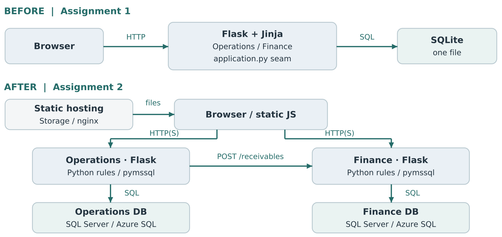
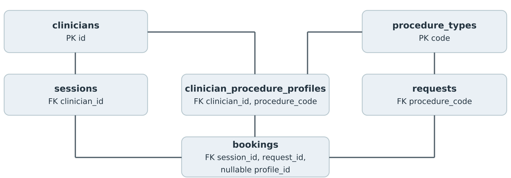
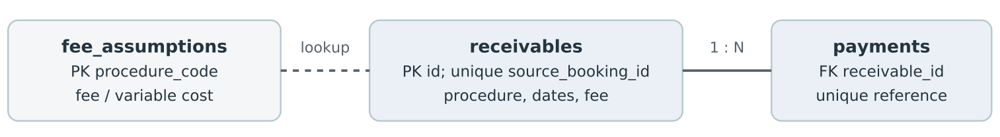
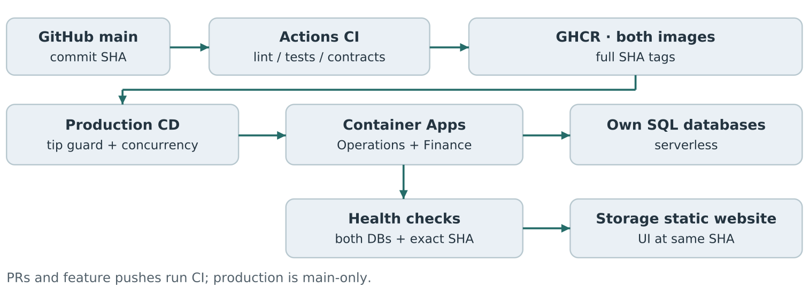

# Medic — Individual Assignment 2 Report

**Individual Assignment 2 · Split, Ship and Operate**

Alejandro Serrano Sánchez · IE University · Software Development & DevOps · 24 Nov 2026

[Repository](https://github.com/alejandroserranosanchez/Medic) · [Live clinic demo](https://aserranoieu2024ui.z28.web.core.windows.net/)

Production evidence: commit `193346c24066ec97c9b765893cf1c6964176b516` (24 Nov). This is an evidence commit, not a claim about the final submission tag.

## 1. Purpose and architecture

Medic is a coursework application for a small diagnostic clinic. It schedules endoscopy sessions without double booking and records money owed for completed procedures. Assignment 1 used a single Flask/Jinja application and SQLite. Assignment 2 keeps the same language and domain split, but runs each domain as a separate service and gives it its own SQL database.

*Figure 1. The browser loads static files and calls both APIs. Only Operations calls Finance across the seam. HTTP locally; HTTPS in Azure.*

The deployed scope is session creation, booking creation, completion, receivable lookup and payments. Equipment comparison and slot recovery remain in the legacy monolith; they were not ported to the static UI. All records are fictional.

I kept the seam from ADR-2: Operations owns capacity, Finance owns money. In Assignment 1 `clinic/application.py` coordinated both writes in one local transaction. With separate service ownership, I replaced that coordination with a server-side HTTP call (ADR-6), rather than making one service read the other database or trusting the browser to coordinate the two writes.

---

## 2. Service interaction and failure handling

The static page sends JSON to Flask routes. Operations checks timing, eligibility and availability; each service uses its own `pymssql` connection configured by `DATABASE_URL`. `urllib.request` sends the cross-service call to `FINANCE_SERVICE_URL` (3-second default timeout). Finance owns the GASTRO (€120) and COLONO (€180) fee catalogue; the caller sends procedure, booking ID and dates, not the fee.

### Completion is not one distributed transaction

Operations validates that the appointment has started and the dates match. It commits `completion_pending` before calling Finance `POST /receivables`. Finance creates the charge or returns the matching existing one. Only a valid 200/201 reply with a receivable ID lets Operations commit `completed` and the plain Finance ID. This avoids reporting completion when the financial result is uncertain.

| Finance or booking outcome | Operations response and persisted state |
| --- | --- |
| First confirmed refusal | 503; restore `active`. No known Finance write. |
| Timeout, unreachable, 5xx | 503; remain `completion_pending`. Retry same details. |
| Matching replay / new charge | Finance 200/201; Operations 200, `completed`. |
| Conflicting retry | 409; pending remains. Do not overwrite charge. |
| Already completed / not started | 200 with saved ID / 400 without a Finance call. |

Finance enforces a unique `source_booking_id` and compares procedure, dates and fee on replay; payment references are also unique. An identical repeated completion after success returns the saved ID without another Finance call. A lost response is not proof that no write happened; a pending booking needs an explicit retry, not an infinite loop or background worker (ADR-7/10).

### Evidence: Finance stopped locally, 24 November

| Action | Observed result |
| --- | --- |
| `docker compose stop finance` | Completion of fictional booking #4: HTTP 503, `completion_pending`; Operations /health: HTTP 200. |
| Restart Finance; retry same POST | HTTP 200, `created`, receivable #4, 12000 cents. |
| Repeat completion | HTTP 200, `already_completed`, same receivable #4. |

Response while Finance was down: `{"booking_status":"completion_pending","error":"finance result is unknown; the booking stays completion_pending"}`

The local past booking was inserted as a test fixture because normal booking creation rejects past slots. Only completion and recovery were exercised over HTTP; Azure was not modified. Full transcript: `docs/evidence/compose-partial-failure-local.txt`. Separate local tests confirm first-refusal versus timeout behaviour. In Azure, the browser rejected early completion with 400 and later completed booking #2, creating receivable #1 (€120).

---

## 3. Data ownership and schema evolution

SQL Server replaces SQLite. Locally, one SQL Server container hosts two databases; `db/init.sql` creates a restricted login for each. Azure uses two serverless databases on one logical server. Each service reads only its own database. No cross-service foreign key exists.

### Operations

*Figure 2. Domain tables and actual internal foreign-key relationships (lines). bookings.finance_receivable_id is a nullable plain ID, not an FK.*

### Finance

*Figure 3. Solid line: payments.receivable_id FK. Dashed line: application fee lookup by procedure code, not a database FK. source_booking_id is unique but not a foreign key.*

Each diagram omits the operational `schema_migrations` and `health_checks` tables, which exist in each database. Monetary values are integer cents; Finance 004 adds a fixed EUR currency column to receivables. The receivable freezes the expected fee, and payments determine the balance without altering the clinical booking.

### Migration evidence and recovery

At startup apply_migrations() sorts numbered SQL files, checks schema_migrations and commits each pending file with its tracking row. Both runners now print the filename after commit. Operations 003 adds completion state; Finance 004 adds currency_code CHAR(3) NOT NULL with an EUR default and check, making the existing single-currency convention explicit. Old files remain unchanged.

Azure evidence (24 Nov, UTC): the before query at 18:47:16 showed receivable #1, booking #2, GASTRO, performed 23 Nov, due 30 Nov, fee 12000 cents and no currency column. After automatic CD, the 19:21:06 query showed the same values plus currency_code=EUR. Migration 004 is recorded at 19:03:15 UTC; COL_LENGTH changed from NULL to 3. Both snapshots use the same Finance database. Payments were empty in both.

Local tests additionally preserve a populated booking (Operations 003) and a receivable with an associated payment (Finance 004), check the EUR default and skip reapplication. The Azure startup log was not retained in the retrieved replica logs; the tracking row confirms application. See docs/evidence/azure-finance-before-004.txt and azure-finance-after-004.txt.

A failed migration may prevent startup. Inspect, repair or restore if needed, then deploy a forward migration (ADR-7); no automatic rollback or database recreation.

---

## 4. Containers, CI/CD and Azure deployment

Each service has its own Dockerfile and pinned Flask/pymssql dependencies, copies only app and migrations, runs as non-root, and embeds `GIT_SHA`. Compose adds SQL Server, a one-off initializer and stock nginx for the UI. The named SQL volume survives container replacement; Azure persists data outside the application containers.

*Figure 4. Main-only production pipeline. Image publishing depends on both service tests and contract validation. The backend and UI deploy under one production concurrency guard.*

Every push and PR installs, lints, tests and builds each service. Coverage below 70% in either service fails CI; OpenAPI and `system.yaml` are validated. Tests use SQL Server on the runner, not Azure. On main, CI publishes both full-SHA GHCR tags and calls Deploy Azure using `workflow_call` and job dependencies. A stale-tip guard skips outdated runs. After both health checks pass for that SHA, Deploy UI checks out the same commit, generates public API configuration and uploads static files. Failed jobs can be rerun; no standalone manual deployment remains.

| Azure resource | Actual name / configuration |
| --- | --- |
| Resource group / environment | `rg-aserrano` / `aserrano-ieu2024-env` |
| Container Apps (Consumption) | `aserrano-ieu2024-operations`, `aserrano-ieu2024-finance`; 0–1 replicas, 0.25 CPU, 0.5 Gi each |
| Logical SQL server / DBs | `aserrano-ieu2024-sql`; `aserrano-ieu2024-operations-db`, `aserrano-ieu2024-finance-db` |
| Static UI / registry | `aserranoieu2024ui` (Storage); `ghcr.io/alejandroserranosanchez` |

OIDC authenticates GitHub Actions to Azure. Database URLs are GitHub secrets passed as Container Apps secret references, not browser configuration. The UI uses blob-data permissions rather than an account key. Static Storage was chosen after SWA creation was denied; this matches the supplied schema but deviates from the brief’s SWA wording (ADR-8).

---

## 5. Verification, decisions and limitations

| Evidence, 24 Nov automatic run | Observed result |
| --- | --- |
| Operations | 49 tests passed; 91.27% coverage |
| Finance | 35 tests passed; 89.74% coverage |
| Contracts / GHCR | Both contracts validated; both SHA images built and published |
| Azure and UI | Both /health returned ok / db ok / exact SHA; UI verification passed |

[Successful automatic CD (45465579181)](https://github.com/alejandroserranosanchez/Medic/actions/runs/45465579181) · [Earlier backend CD (45236916979)](https://github.com/alejandroserranosanchez/Medic/actions/runs/45236916979). The first Storage deployment failed because management-plane Contributor did not permit blob uploads. Granting scoped Storage Blob Data Contributor to the OIDC identity fixed it; [failed attempt and successful rerun (45246257719)](https://github.com/alejandroserranosanchez/Medic/actions/runs/45246257719).

Health reads and writes the service’s own database and returns its image SHA, or 503 when that database is unavailable. It does not check the peer. Request logs include method, path, status and duration on stdout. The cross-seam suite tests timeout/refusal, retry and real Finance HTTP integration, in addition to the Compose outage transcript. No full browser suite or cloud cold-start test is run in CI.

### Trade-offs and remaining limitations

Consumption apps scale to zero and SQL serverless auto-pauses, reducing idle compute cost (storage can still be billed). Cold starts and SQL resume can delay requests. The driver currently has five-second login/query timeouts, not application-level retry/backoff; deployment polls health with bounded retries. At much higher traffic I would revisit replica limits, safe migration coordination, database capacity and asynchronous recovery. A broker is deliberately omitted in this coursework.

The class resource group was unavailable during setup; the deployed system uses a personal resource group and OIDC identity, not the required class group/principal. Azure Storage replaces SWA; the supplied schema explicitly uses `storage_account`. These are deviations, not full compliance. The UI remembers bookings in browser local storage and has no server-wide booking list; legacy equipment and slot-recovery features were not ported. CORS restricts browser origins but is not authentication. This public demo must contain fictional data only.

### AI disclosure

I acknowledge the use of ChatGPT to plan, review and troubleshoot the system, explain technical concepts, and prepare this report, and of Cursor to generate and revise Flask/SQL code, tests, Dockerfiles, Compose, GitHub Actions, contracts and documentation. The prompts used include diagnosing Entra-only SQL authentication, implementing timeout/idempotency, fixing Storage upload permissions and automating main-only CD. The output of these prompts was used as a starting point for code, tests, deployment and documentation that I reviewed and ran. The detailed interaction log is in `AI_USAGE.md`.

**Live URL:** [https://aserranoieu2024ui.z28.web.core.windows.net/](https://aserranoieu2024ui.z28.web.core.windows.net/)
