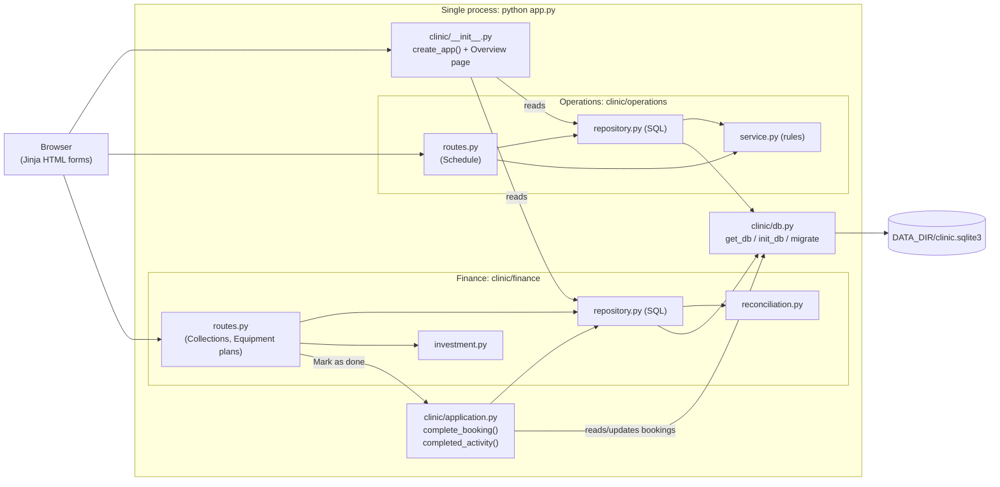
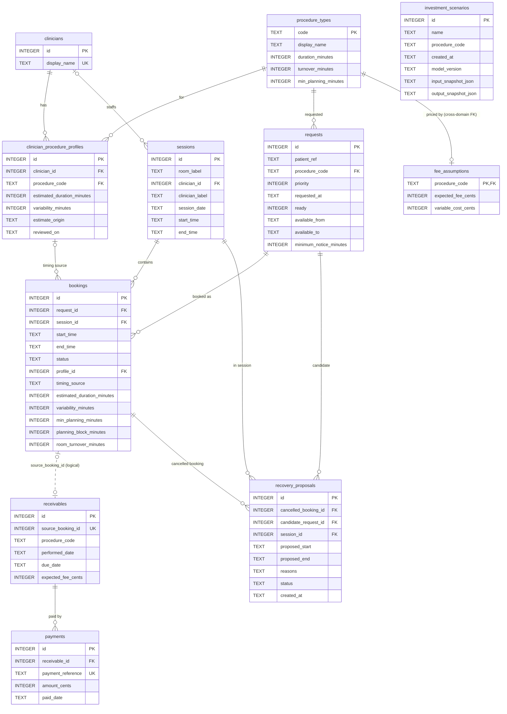

# Medic — Individual Assignment 1 Report

**Student:** Alejandro Serrano Sánchez · **Course:** Software Development & DevOps (IE University, BCSAI 2026–27)
**Repository:** https://github.com/alejandroserranosanchez/Medic · **Report date:** 2026-10-12
**Working name:** Medic (earlier provisional name: CareQuanta). All clinic data is fictional.

## 1. Problem, users and scope (Planning phase)

**Problem.** The manager of a small private diagnostic clinic has three linked questions: (1) can cancelled appointment capacity be reused without double booking? (2) have completed procedures been paid correctly? (3) would keeping, buying or leasing equipment actually raise throughput, or is staff/room the real limit?

**Stakeholders (invented for this course).** Clinic manager (primary user, decides on equipment); scheduling coordinator (books and cancels); billing clerk (records payments); clinicians (their personal timing profiles drive booking length). Patients are affected but never use the tool; only fictional references such as `P-1001` are stored.

**Feasibility (SDLC lecture).** *Technical:* yes, Python, Flask and SQLite are a stack I already use; one process, no external services. *Operational:* plausible for one coordinator (four screens, plain forms, no login), not validated with a real clinic. *Economic:* not evaluated with real figures; the Equipment plans screen models the clinic's decision, not this product's business case.

**Scope.** One clinic, EUR, one time zone, two procedures (gastroscopy, colonoscopy). Out of scope: real patient data, diagnosis, hospital/insurer integrations (ADR-5), Docker/CI/IaC, public deployment, login.

**Requirements.** *Functional:* create sessions, waiting requests and bookings and reject room/clinician overlaps; the server calculates the booking end time from the clinician's profile; cancelling frees capacity and creates nothing to collect; marking a started booking as done creates exactly one receivable; a free slot lists waiting patients ranked by priority and waiting time, with a reason for each one who can't be booked; payments label each receivable unpaid / partial / settled / overpaid, with a separate overdue flag; keep / buy / lease can be compared, saved and reopened. *Non-functional:* single process started by `python app.py`, bound to `0.0.0.0`, configured only by environment variables (`PORT`, `DATA_DIR`, `APP_NAME`, `SECRET_KEY`, `DEMO_NOW`); money in integer cents; ≥70% coverage of core logic in each domain.

### SMART goals and actual outcome

| Goal (Specific, Measurable, Achievable, Relevant, Time-bound) | Outcome |
|---|---|
| G1. Deliver persisted scheduling, payment and equipment flows, all reading/writing SQLite, by 11 Oct. | **Met on 10 Oct.** Slot recovery and the completion-date rule were added on 12 Oct. |
| G2. ≥70% line coverage on the core logic of each domain before submission. | **Met:** Operations 83.51%, Finance 82.65%, combined 83.65% (§5). |
| G3. Start cleanly with `python app.py` on a fresh `DATA_DIR` within a few seconds. | **Met:** checked 12 Oct with an empty temporary directory; the database is created and seeded automatically and all pages answer HTTP 200. |
| G4. ≥12 meaningful commits over ≥6 distinct days, none >40%. | **Partly met:** 14 commits including the final one, largest day 12 Oct with 5/14 = 35.7%, but only **5 days** (6, 7, 9, 10, 12 Oct): nothing was committed on 8 and 11 Oct. |

### Risk matrix (likelihood × severity)

| Risk | Likelihood | Severity | Level | Mitigation actually applied |
|---|---|---|---|---|
| Two requests book the same slot | Possible | Intolerable | Extreme | `BEGIN IMMEDIATE` before checking, re-validation inside the transaction |
| Rounding errors in balances | Possible | Undesirable | High | Integer cents; `euros_to_cents` rejects more than 2 decimals |
| One domain's coverage hides the other's | Probable | Undesirable | High | Coverage measured per domain, not only combined |
| Amount due created for work not yet done | Possible | Undesirable | High | **Happened** (found 12 Oct); `complete_booking` now refuses bookings that haven't started |
| Schedule slip | Probable | Undesirable | High | **Happened** (8 and 11 Oct lost); recovered by fixing defects first on 9 Oct |

## 2. SDLC model: iterative and incremental, with a planning gate

**Chosen model.** An *iterative, incremental* model (Agile-style short increments) with one Waterfall-like gate at the start: the assignment requires professor approval before code, so 6 Oct was documentation only (brief, acceptance criteria, ADR-1). After approval each day was a small increment of design → build → test → commit/push.

**Why not pure Waterfall.** Requirements changed mid-project. On 7 Oct a review found that booking duration was ignored and that eligibility fields were stored but never checked, so I added per-clinician timing profiles. On 12 Oct a UI review showed a booking could be marked as done before it started. Waterfall would have found these late; iterations let me fix them in the next increment, each with a regression test.

| Date | Increment (from Git history) | SDLC phases touched |
|---|---|---|
| 6 Oct | Scope, acceptance criteria, ADR-1 | Planning, requirements |
| 7 Oct | Flask + SQLite foundation; capacity conflicts + tests; ADR-2/3 | Design, development, testing |
| 9 Oct | Fixed review defects (profiles, eligibility, transactions); completion → receivable; payments; ADR-4 | Maintenance feedback → design, development, testing |
| 10 Oct | Keep/buy/lease comparison; saved scenarios; ADR-5 | Development, testing |
| 12 Oct | Removed a cross-domain import; config/HTTP tests; schedule timeline and slot recovery; completion-date fix; this report | Testing, design, maintenance, documentation |

**Honest deviations.** Two days (8 and 11 Oct) were lost, so the commit-day target was missed. I did not follow TDD (red → green → refactor): tests were written alongside or just after each function, but every defect found in review became a regression test (e.g. `test_vega_profile_block_is_30_not_raw_estimate`, `test_cannot_complete_booking_before_it_starts`).

## 3. Architecture (High-Level Design)

One Flask process, one SQLite file, two backend domains, and one application service where they meet.



**Boundary rules (ADR-2).** `clinic/operations` never imports `clinic/finance`, and Finance never imports Operations. Only two places know both: the read-only Overview page in the app factory, and `clinic/application.py`. `complete_booking` marks the booking `completed` and asks Finance to insert one receivable with a frozen fee, in one SQLite transaction: if either write fails, both roll back. It also refuses a booking that hasn't started, a performed date other than the session date, and a due date before it. `completed_activity` gives Collections the procedure and patient behind each receivable without Finance reading Operations tables. The seam for a future split into two services is this module plus the `source_booking_id` column.

**Known monolith couplings.** `fee_assumptions.procedure_code` has a real foreign key to the Operations catalogue, and `application.py` reads the `bookings` table directly. After a split, both would become API calls.

## 4. Data model (matches ADR-3 and `clinic/schema.sql`)

Solid lines are declared SQLite `FOREIGN KEY`s. The dotted line is a **logical** reference only: `source_booking_id` is `UNIQUE` but deliberately has no foreign key (ADR-3). `schema_migrations` (`id`, `applied_at`) only records which database upgrade has run and is not drawn.



**Integrity rules.** A partial unique index (`idx_one_active_booking_per_request`) allows at most one *active* booking per request. Each booking stores a **snapshot** of its timing, so editing a clinician profile never moves old bookings; each receivable stores `expected_fee_cents` at completion, so later fee edits never rewrite history; investment scenarios store input and output as JSON snapshots. `recovery_proposals` is reserved for saving slot-recovery suggestions: today they are calculated live and not stored.

**Core formulas.**

```text
planning_block   = max(centre_minimum, profile_estimate + variability)
room_occupied_to = start + planning_block + room_turnover      # half-open [start, end)
procedures_per_month(option) = min(demand, staff, room, equipment(option))
horizon_cash(option) = months × (q×receipt − q×variable − extra_staff − equipment_monthly) − upfront
```

Test example: demand 30, staff 12, room 20; raising equipment from 10 to 40 gives **12** procedures/month, not 40, because staff becomes the limit. Over 12 months keep = €11,400, buy = €8,080, lease = €10,080: more equipment is not automatically a better decision.

## 5. Testing

**Tooling and command.** `pytest` 9.0.2, `pytest-cov` 7.1.0, Python 3.10.0:
`python -m pytest --cov=clinic.operations --cov=clinic.finance --cov=clinic.application --cov=clinic.timeutil --cov-report=term-missing --cov-fail-under=70`

**Result (12 Oct 2026):** 53 passed; combined 83.65%, Operations-only 83.51%, Finance-only 82.65%. Rule modules: `reconciliation.py` 100%, `investment.py` 95%, `operations/service.py` 90%. Routes are lower (73–76%) by design (ADR-4).

| Level (testing pyramid) | Count | Examples |
|---|---|---|
| Unit (pure functions) | 25 (47%) | `compute_timing_plan`, `session_conflicts`, `free_gaps`, `classify_balance`, `procedures_per_month` |
| Integration (temporary SQLite) | 21 (40%) | double booking rejected; restart persistence; ranked slot candidates with reasons; complete → one receivable; completion refused before start or with a wrong date; scenario save/reload |
| HTTP (Flask test client) | 7 (13%) | pages load; invalid form shows a message, not a 500; cancel shows replacement patients; completing twice creates one receivable; "Mark as done" refused early and only offered for started bookings |
| End-to-end browser | 0 | not written (out of scope) |

My unit share is below the lecture's 70–80% guideline: several key rules (no double booking, snapshot immutability, one receivable per booking) are about database state, so I tested them as integration tests.

**Course techniques used.** Arrange–Act–Assert; a function-scoped `yield` fixture (`app` in `tests/conftest.py`) giving each test its own `tmp_path` database (FIRST: *Independent*); `@pytest.mark.parametrize` for the balance labels and invalid completion dates; `pytest.raises(..., match=...)`; `monkeypatch.setenv` for `PORT`, `DATA_DIR` and `DEMO_NOW`. A fixed clock (`DEMO_NOW`) avoids the "system-clock dependence" cause of flaky tests (FIRST: *Repeatable*). No mocks were needed: there is no external API and a temporary SQLite file is cheap.

**Limits.** 83% coverage does not prove correctness. The clinical timing values are fictional. `BEGIN IMMEDIATE` protects against concurrent bookings, but no test runs two real simultaneous requests.

## 6. Course concepts as they appear in the code

| Concept | Where it appears | How far it goes |
|---|---|---|
| SRP | Each domain splits `routes.py` (HTTP), rules (`service.py`, `reconciliation.py`, `investment.py`) and `repository.py` (SQL), like the lecture's Validator/Calculator/Repository refactor. | Applied |
| DIP (injection idea) | Repository and service functions receive `db` as a parameter, so tests pass a temporary database. | Partial: no abstract interface |
| Facade-like coordinator | `complete_booking` is one entry point hiding two subsystems, like the lecture's refactored `OrderService`. | Similar idea, not a full pattern |
| Patterns not used | No Singleton/Builder/Strategy: no class hierarchy needs them, and the lecture warns Builder can over-engineer simple models. | Deliberate |
| Git | Commit = local snapshot; push = publish to `origin/main` (what graders see). One developer committing to `main` (trunk-style), no branches or PRs needed. | Applied |

## 7. AI disclosure

> I acknowledge the use of **ChatGPT** to draft the initial project plan, and of **Cursor (AI coding assistant)** to refine the project scope, generate and revise Python/Flask/SQL code, write pytest tests, and draft documentation including this report. The prompts used include: "complete tonight's two documentation checkpoints while professor approval is pending", "build a solid Flask/SQLite foundation with brief explanations", "fix booking duration with clinician profiles and eligibility", "add booking completion, receivables and payment reconciliation", "add keep/buy/lease investment with saved scenarios", "check the project against my course notes before submission", "make the app design and flow more intuitive, based on my original plan", and "perform a final submission audit against the assignment brief". The output of these prompts was used as a starting point that I ran, tested, reviewed and committed myself; the detailed per-interaction log, including my own explanations, is in `AI_USAGE.md`. I learnt a lot using AI.
