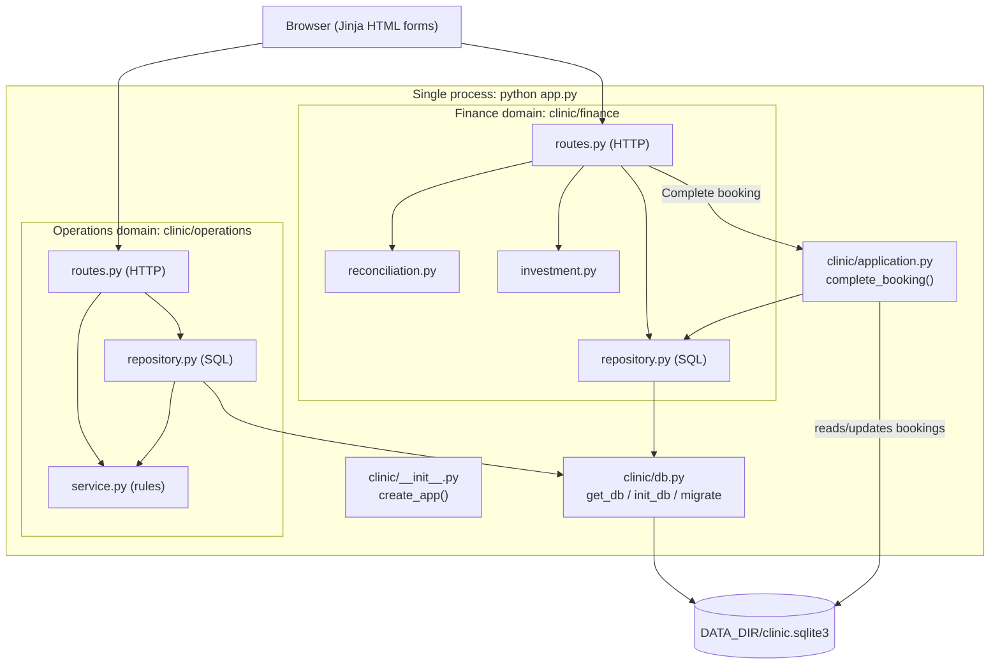
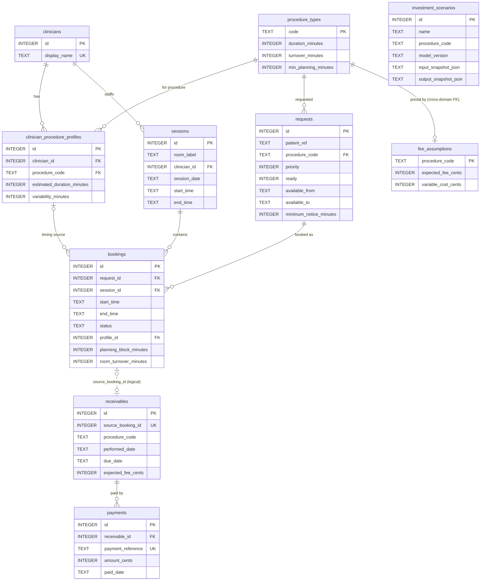

# Medic — Individual Assignment 1 Report

**Student:** Alejandro Serrano Sánchez · **Course:** Software Development & DevOps (IE University, BCSAI 2026–27)
**Repository:** `git@github.com:alejandroserranosanchez/medic.git` · **Report date:** 2026-10-12
**Working name:** Medic (earlier provisional name: CareQuanta). All clinic data is fictional.

---

## 1. Problem, users and scope (Planning phase)

**Problem.** The manager of a small private diagnostic clinic has three linked questions: (1) can cancelled appointment capacity be reused without double booking? (2) have completed procedures been paid correctly? (3) would keeping, buying or leasing equipment actually raise throughput, or is staff/room the real limit?

**Stakeholders (invented for this course).** Clinic manager (primary user, decides on equipment); scheduling coordinator (books and cancels); billing clerk (records payments); clinicians (their personal timing profiles drive booking length). Patients are affected but never use the tool, and only fictional references such as `P-1001` are stored.

**Feasibility (the three tests from the SDLC lecture).**

| Test | Answer for Medic |
|---|---|
| Technical | Yes: Python, Flask and SQLite are a stack I already use; one process, no external services. |
| Operational | Plausible for one coordinator: four screens, plain forms, no login. Not validated with a real clinic. |
| Economic | Not evaluated with real figures. The investment screen models *the clinic's* equipment decision, not this product's business case. |

**Scope.** One clinic, EUR, one local time zone, two procedures (gastroscopy, colonoscopy). Out of scope: real patient data, diagnosis, hospital/insurer integrations (ADR-5), Docker/CI/IaC, public deployment, login.

### Requirements

| Type | Requirement |
|---|---|
| Functional | Create sessions, waiting requests and bookings; reject room/clinician overlaps. |
| Functional | Booking end time is calculated by the server from the session clinician's profile (or catalogue default). |
| Functional | Cancel a booking (frees capacity, creates no receivable); complete a booking (creates exactly one receivable). |
| Functional | For a free slot, list waiting patients ranked by priority and waiting time, with a reason for each one who can't be booked. |
| Functional | Record payments; label each receivable unpaid / partial / settled / overpaid, with a separate overdue flag. |
| Functional | Compare keep / buy / lease for one procedure; save and reopen the scenario. |
| Non-functional | Single process started by `python app.py`; binds `0.0.0.0`; config only through env vars (`PORT`, `DATA_DIR`, `APP_NAME`, `DEMO_NOW`). |
| Non-functional | Money stored as integer cents; no binary floats for balances. |
| Non-functional | ≥70% coverage of core business logic in **each** domain. |

### SMART goals and actual outcome

| Goal (Specific, Measurable, Achievable, Relevant, Time-bound) | Outcome |
|---|---|
| G1. Deliver persisted Capacity, Payments and Investment flows, all reading/writing SQLite, by 11 Oct. | **Met on 10 Oct** for the three flows. Slot recovery (suggesting a replacement patient for a freed slot) was added late, on 12 Oct; suggestions are calculated live and not saved. |
| G2. Reach ≥70% line coverage on core logic of each domain before submission. | **Met:** Operations 83.51%, Finance 82.65%, combined 83.65% (measured 12 Oct, §5). |
| G3. Start cleanly with `python app.py` on a fresh `DATA_DIR` within a few seconds. | **Met:** checked 12 Oct with `PORT=8765` and an empty temp dir; DB created automatically, all pages HTTP 200 within the 2-second wait used. |
| G4. ≥12 meaningful commits over ≥6 distinct days, none >40%. | **Partly met.** Work was committed on 6, 7, 9, 10 and 12 Oct = **5 days**; no commits on 8 and 11 Oct. *(Alejandro: confirm final commit count from `git log` before submitting.)* |

### Risk matrix (likelihood × severity, as in the SDLC lecture)

| Risk | Likelihood | Severity | Level | Mitigation actually applied |
|---|---|---|---|---|
| Two requests book the same slot | Possible | Intolerable | Extreme | `BEGIN IMMEDIATE` before checking + re-validation inside the transaction |
| Rounding errors in balances | Possible | Undesirable | High | Integer cents; `euros_to_cents` rejects >2 decimals |
| One domain's coverage hides the other's | Probable | Undesirable | High | Coverage measured per domain, not only combined |
| Schedule slip | Probable | Undesirable | High | **Happened** (8 and 11 Oct lost); recovered by fixing defects first on 9 Oct |

---

## 2. SDLC model: iterative and incremental, with a planning gate

**Chosen model.** An *iterative, incremental* model (Agile-style short increments) with one Waterfall-like gate at the start: the assignment requires professor approval before code, so 6 Oct was documentation only (brief, acceptance criteria, ADR-1). After approval, every day was planned as a small increment of design → build → test → commit/push.

**Why not pure Waterfall.** Requirements changed mid-project: on 7 Oct a review found that booking duration was ignored and that eligibility fields were stored but never checked. On the same day I decided to add per-clinician timing profiles. Waterfall would have discovered this late; iterations let me fix it the next working day.

**What happened in practice (from Git history).**

| Date | Increment | SDLC phases touched |
|---|---|---|
| 6 Oct | Scope, acceptance criteria, ADR-1 | Planning, requirements |
| 7 Oct | Flask + SQLite foundation; capacity conflicts + tests; ADR-2/3 | Design, development, testing |
| 8 Oct | *No work committed* | — |
| 9 Oct | Fixed review defects (profiles, eligibility, transactions); completion → receivable; payments; ADR-4 | Maintenance feedback → design, development, testing |
| 10 Oct | Keep/buy/lease investment; saved scenarios; ADR-5 | Development, testing |
| 11 Oct | *No work committed* | — |
| 12 Oct | Removed a cross-domain import, added config/HTTP tests; reviewed the UI against the original plan and redesigned the flow (schedule timeline, slot recovery, collection records, option cards); fixed a lifecycle defect found in the UI review (a booking could be marked as done before it started, with any performed date); this report | Testing, design, maintenance, documentation |

**Honest deviations.** Two days were lost, so the commit-day target was missed. I did not follow TDD (red → green → refactor): tests were written alongside or just after each function. On 9 Oct the defects found in review became regression tests (e.g. `test_vega_profile_block_is_30_not_raw_estimate`).

---

## 3. Architecture (High-Level Design)

One Flask process, one SQLite file, two backend domains and one application service where they meet.



**Boundary rules (ADR-2).** `clinic/operations` never imports `clinic/finance`, and Finance code never imports Operations modules. The one action needing both (completing a booking) lives in `clinic/application.py`. In one SQLite transaction it marks the booking `completed` and asks Finance to insert one receivable with a frozen fee. If either write fails, both roll back. The seam for a future split into two services is exactly this function plus the `source_booking_id` column.

**Known monolith couplings (stated, not hidden).** `fee_assumptions.procedure_code` has a real FK to the Operations catalogue table. `complete_booking` reads the `bookings` table directly. After a split, both would become an API call.

---

## 4. Data model (Low-Level Design, matches ADR-3 and `clinic/schema.sql`)

Solid lines = SQLite `FOREIGN KEY` actually declared. Dotted line = **logical** reference only (`source_booking_id` is `UNIQUE` but deliberately has no FK, per ADR-3).



Two tables exist in the schema but are not shown above because no feature uses them yet: `recovery_proposals` (reserved for saving slot-recovery suggestions; today they are calculated live and not stored) and `schema_migrations` (records which upgrade has run).

**Integrity rules worth knowing.**
- Partial unique index `idx_one_active_booking_per_request`: at most one *active* booking per request.
- Each booking stores a **snapshot** of its timing (estimate, variability, block, turnover), so editing a clinician's profile later never moves old bookings.
- Each receivable stores `expected_fee_cents` at completion time, so later fee edits never rewrite history.
- Investment scenarios store input and output as JSON snapshots (immutable records; relational queries are not needed on them).

**The two core formulas.**

```text
planning_block   = max(centre_minimum, profile_estimate + variability)
room_occupied_to = start + planning_block + room_turnover      # half-open [start, end)

procedures_per_month(option) = min(demand, staff, room, equipment(option))
horizon_cash(option) = months × (q×receipt − q×variable − extra_staff − equipment_monthly) − upfront
```

Example used in tests: demand 30, staff 12, room 20, equipment 10 → 40 gives 10 → **12** procedures/month (staff-limited, not 40). Over 12 months, keep = €11,400, buy = €8,080, lease = €10,080. More equipment does not automatically mean a better decision.

---

## 5. Testing

**Tooling.** `pytest` 9.0.2 and `pytest-cov` 7.1.0, Python 3.10.0. Command:

```bash
python -m pytest --cov=clinic.operations --cov=clinic.finance --cov=clinic.application \
  --cov=clinic.timeutil --cov-report=term-missing --cov-fail-under=70
```

**Result (12 Oct 2026):** 53 passed. Combined 83.65%; Operations-only 83.51%; Finance-only 82.65%. Business-rule modules: `reconciliation.py` 100%, `investment.py` 95%, `operations/service.py` 90%. Routes are lower (70–75%) by design (ADR-4).

**Testing pyramid (lecture levels).**

| Level | Count | Examples |
|---|---|---|
| Unit (pure functions) | 25 (47%) | `compute_timing_plan`, `session_conflicts`, `free_gaps`, `classify_balance`, `procedures_per_month` |
| Integration (temp SQLite) | 21 (40%) | double booking rejected, restart persistence, ranked slot candidates with reasons, complete → one receivable, completion refused before the booking starts or with a wrong date, scenario save/reload |
| HTTP through Flask test client | 7 (13%) | pages load; invalid form shows message not 500; cancel shows replacement patients; completing twice creates one receivable; "Mark as done" refused early and only offered for started bookings |
| End-to-end browser | 0 | not written (Playwright/Selenium out of scope) |

My unit share is below the lecture's 70–80% guideline. Several key rules (no double booking, snapshot immutability, one receivable per booking) are about database state, so I tested them as integration tests.

**Course techniques used.** Arrange–Act–Assert layout; a function-scoped `yield` fixture (`app` in `tests/conftest.py`) giving every test its own `tmp_path` database (FIRST: *Independent*); `@pytest.mark.parametrize` for the five balance labels; `pytest.raises(..., match=...)` for validation errors; `monkeypatch.setenv` for `PORT`, `DATA_DIR` and `DEMO_NOW`. A fixed planning clock (`DEMO_NOW`) avoids the lecture's "system-clock dependence" cause of flaky tests (FIRST: *Repeatable*). Mocks were not needed: there is no external API, and a real temporary SQLite file is cheap.

**Limits.** 83% coverage does not prove correctness. The clinical timing values are fictional assumptions. Concurrency protection was reasoned about and coded with `BEGIN IMMEDIATE`, but no test runs two real simultaneous requests.

---

## 6. Course concepts as they appear in the code

| Concept from the course | Where it appears | How far it goes |
|---|---|---|
| SRP | Each domain splits `routes.py` (HTTP), `service.py`/`reconciliation.py`/`investment.py` (rules), `repository.py` (SQL), like the lecture's Validator/Calculator/Repository refactor. | Applied |
| DIP (idea of injection) | Every repository/service function receives `db` as a parameter instead of opening its own connection, so tests pass a temporary database. | Partial: no abstract interface |
| Facade-like coordinator | `complete_booking` gives one entry point that hides two subsystems, like the lecture's refactored `OrderService`. | Similar idea, not a full pattern |
| Unit conversion (StreamFlix cents lesson) | `euros_to_cents` turns user euros into integer cents. | Same lesson; not the Adapter pattern |
| Patterns not used | No Singleton/Builder/Strategy etc. The problem has no class hierarchy that needs them, and the lecture warns Builder can over-engineer simple models. | Deliberate |
| Git: commit vs push | Commit = local snapshot; push = publish to `origin/main` (what graders see). | Applied daily |
| Git workflow | One developer committing straight to `main` (trunk-style); no feature branches or PRs were needed. | Applied |

---

## 7. AI disclosure

> I acknowledge the use of **ChatGPT** to draft the initial project plan, and of **Cursor (AI coding assistant)** to refine the project scope, generate and revise Python/Flask/SQL code, write pytest tests, and draft documentation including this report. The prompts used include: "complete tonight's two documentation checkpoints while professor approval is pending", "build a solid Flask/SQLite foundation with brief explanations", "fix booking duration with clinician profiles and eligibility", "add booking completion, receivables and payment reconciliation", "add keep/buy/lease investment with saved scenarios", "check the project against my course notes before submission", and "make the app design and flow more intuitive, based on my original plan". The output of these prompts was used as a starting point that I ran, tested, reviewed and committed myself; the detailed per-interaction log, including my own explanations, is in `AI_USAGE.md`.

*(Alejandro: read this statement and edit any wording that does not match how you actually worked.)*
